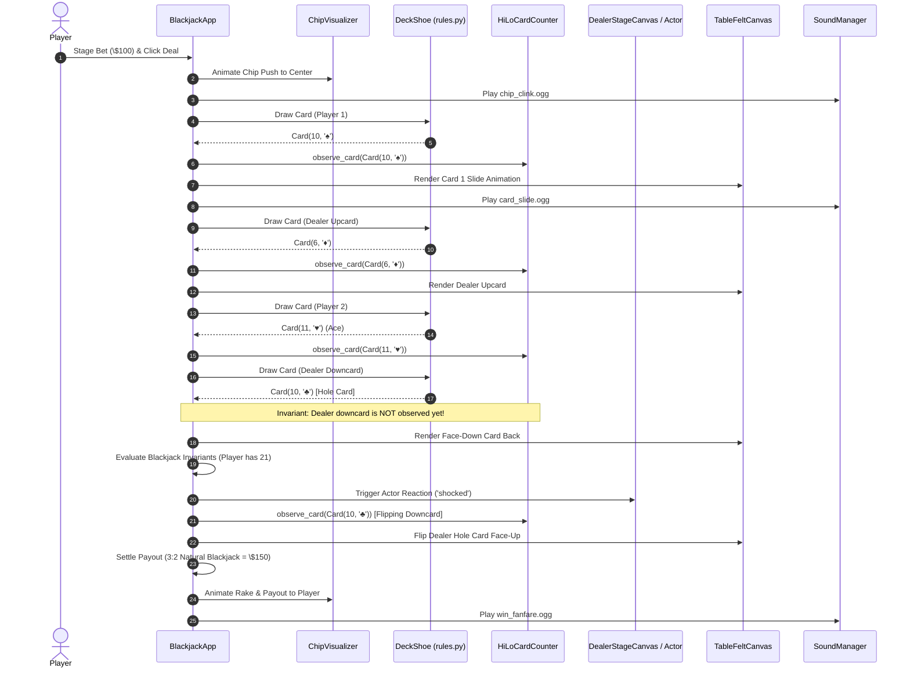
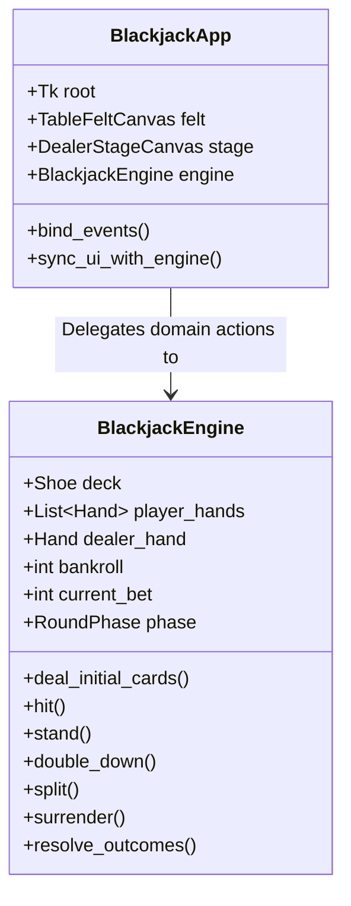
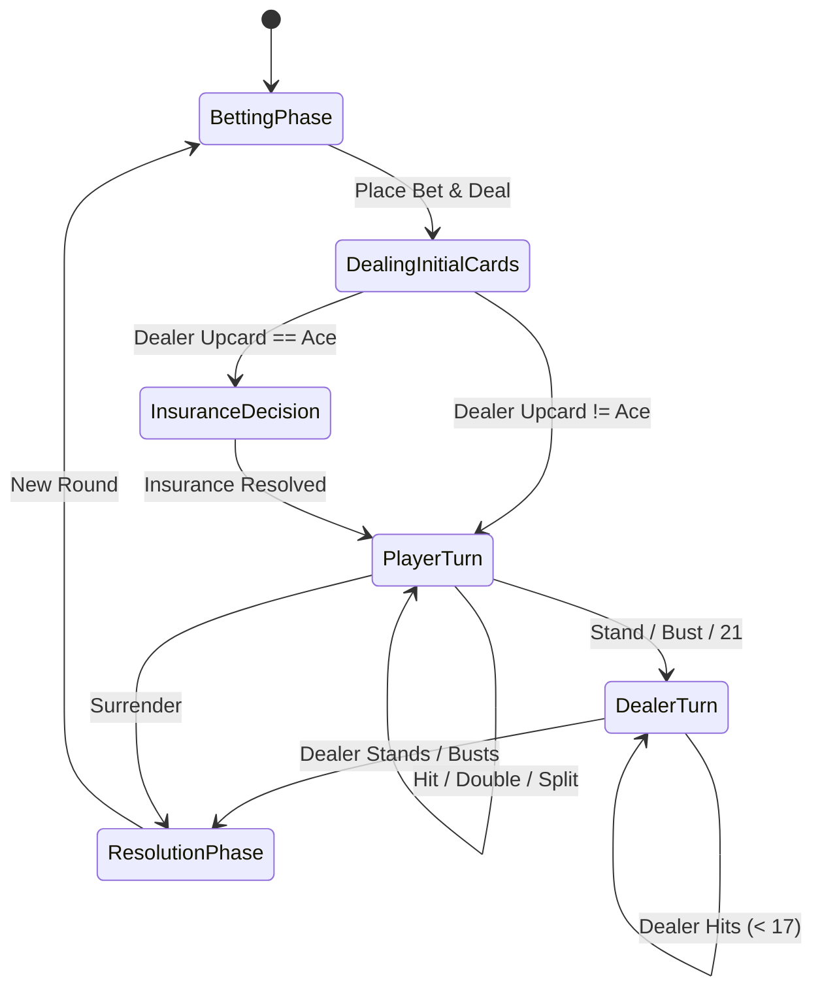

# Blackjack Architecture & CRC Cards Documentation

This document provides a comprehensive structural reference for the **Blackjack** desktop application using **Class-Responsibility-Collaboration (CRC) Cards**, accompanied by system interaction diagrams and an architectural review identifying high-leverage areas of potential improvement.

---

## Table of Contents
1. [Architectural Overview & Subsystem Map](#1-architectural-overview--subsystem-map)
2. [Class-Responsibility-Collaboration (CRC) Cards](#2-class-responsibility-collaboration-crc-cards)
   - [Subsystem A: Core Game Domain & Rules](#subsystem-a-core-game-domain--rules)
   - [Subsystem B: Progression & Haunted Game Modes](#subsystem-b-progression--haunted-game-modes)
   - [Subsystem C: Dealer Puppet Engine & Dialogue Voice](#subsystem-c-dealer-puppet-engine--dialogue-voice)
   - [Subsystem D: Audio, Assets & Theme Configuration](#subsystem-d-audio-assets--theme-configuration)
   - [Subsystem E: Persistence, Records & Achievements](#subsystem-e-persistence-records--achievements)
   - [Subsystem F: Table Felt Canvases & In-Table HUDs](#subsystem-f-table-felt-canvases--in-table-huds)
   - [Subsystem G: Modal Dialogs & Specialized Views](#subsystem-g-modal-dialogs--specialized-views)
   - [Subsystem H: Central Orchestration Controller](#subsystem-h-central-orchestration-controller)
3. [System Collaboration Flows](#3-system-collaboration-flows)
   - [Round Deal & Lifecycle Sequence](#round-deal--lifecycle-sequence)
   - [Card Counting & Hole Card Privacy Invariant](#card-counting--hole-card-privacy-invariant)
   - [Haunted Altar & Supernatural Dialogue Flow](#haunted-altar--supernatural-dialogue-flow)
4. [Critical Review & Areas of Potential Improvement](#4-critical-review--areas-of-potential-improvement)
   - [1. Deconstruction of the `BlackjackApp` God Object](#1-deconstruction-of-the-blackjackapp-god-object)
   - [2. Event-Driven Observer / Pub-Sub Architecture](#2-event-driven-observer--pub-sub-architecture)
   - [3. Formalization of Domain Models & Typing](#3-formalization-of-domain-models--typing)
   - [4. Pure FSM (Finite State Machine) State Transition Validator](#4-pure-fsm-finite-state-machine-state-transition-validator)
   - [5. Decoupling View Presentation from Table Felt State](#5-decoupling-view-presentation-from-table-felt-state)
5. [Summary Matrix of Improvement Recommendations](#5-summary-matrix-of-improvement-recommendations)

---

## 1. Architectural Overview & Subsystem Map

The application is structured into decoupled domain rules, puppet presentation components, procedural audio synthesizers, persistence managers, and a centralized Tkinter GUI controller:

```mermaid
graph TD
    subgraph Core Domain [Core Rules & Domain]
        rules[rules.py: Card, RoundPhase, BasicStrategyDecision]
        counter[card_counter.py: HiLoCardCounter]
    end

    subgraph Meta Game [Progression & State]
        haunted[haunted_manager.py: HauntedManager, Blessing]
        save[save_manager.py: SaveManager, SaveData, Achievements]
    end

    subgraph Audio & Assets [Audio & Theme Subsystem]
        audio[audio_assets.py: SoundManager, AssetScaler]
        voice[dialogue_voice_engine.py: AnimaleseVoiceEngine]
        config[config.py: ThemePalette]
    end

    subgraph Dealer Actor [Puppet & Actor Subsystem]
        actor[dealer_actor.py: DealerActor, CharacterProfile]
    end

    subgraph Presentation Canvases [Canvases & In-Table HUDs]
        stage_c[ui_canvases.py: DealerStageCanvas]
        felt_c[ui_canvases.py: TableFeltCanvas]
        chip_c[ui_canvases.py: ChipVisualizer]
        altar_c[ui_canvases.py: HauntedAltarCanvas]
        soul_c[ui_canvases.py: SoulMeterCanvas]
        hud[ui_canvases.py: TableAnnouncementHUD]
        count_hud[card_counting_hud.py: CardCountingHud, FloatingCountBadge]
    end

    subgraph Modal Views [Toplevel Dialogs]
        settings_dlg[ui_dialogs.py: SettingsDialog]
        shortcuts_dlg[ui_dialogs.py: ShortcutsDialog]
        splash_dlg[ui_dialogs.py: WelcomeSplashDialog]
        story_dlg[ui_dialogs.py: StoryDialogueDialog]
        draft_dlg[ui_dialogs.py: AngelicDraftDialog]
        wardrobe_dlg[dealer_wardrobe_dialog.py: WardrobeDialog]
        quiz_dlg[card_counting_hud.py: CardCountingQuizDialog]
    end

    subgraph Orchestration [Central Controller]
        app[blackjack.py: BlackjackApp]
    end

    app --> rules
    app --> counter
    app --> haunted
    app --> save
    app --> audio
    app --> voice
    app --> actor
    app --> stage_c
    app --> felt_c
    app --> chip_c
    app --> altar_c
    app --> soul_c
    app --> hud
    app --> count_hud

    app --> settings_dlg
    app --> shortcuts_dlg
    app --> splash_dlg
    app --> story_dlg
    app --> draft_dlg
    app --> wardrobe_dlg
    app --> quiz_dlg

    stage_c --> actor
    actor --> voice
    actor --> audio
```



---

## 2. Class-Responsibility-Collaboration (CRC) Cards

---

### Subsystem A: Core Game Domain & Rules

#### `Card` ([rules.py](../rules.py#L32))
| Responsibility | Collaboration |
| :--- | :--- |
| **Knows**: Rank (`int` 1--13), suit (`str` `♠`, `♥`, `♦`, `♣`), face value, display label, and asset file name.<br>**Knows**: Special card identity (e.g. Card 13 cursed Card of Skulls, Ace soft value).<br>**Does**: Formats rank string (`"A"`, `"K"`, `"13"`), computes point values, and checks blackjack / bust properties. | None (Pure immutable value object / dataclass). |

#### `RoundPhase` ([rules.py](../rules.py#L18))
| Responsibility | Collaboration |
| :--- | :--- |
| **Knows**: Enumerated round lifecycles (`BETTING`, `DEALING`, `PLAYER_TURN`, `DEALER_TURN`, `ROUND_OVER`, `SHUFFLING`).<br>**Does**: Provides standard state identifiers across the game lifecycle. | Collaborates with [BlackjackApp](../blackjack.py) and [TableAnnouncementHUD](../ui_canvases.py#L556). |

#### `BasicStrategyDecision` ([rules.py](../rules.py#L226))
| Responsibility | Collaboration |
| :--- | :--- |
| **Knows**: Optimal mathematical Blackjack decisions (`HIT`, `STAND`, `DOUBLE`, `SPLIT`, `SURRENDER`).<br>**Does**: Evaluates player hand vs. dealer upcard according to standard casino multi-deck basic strategy charts (hard totals, soft totals, pair splitting). | Collaborates with [Card](../rules.py#L32) and [BlackjackApp](../blackjack.py). |

#### `HiLoCardCounter` ([card_counter.py](../card_counter.py#L14))
| Responsibility | Collaboration |
| :--- | :--- |
| **Knows**: Running count (RC), total cards observed, initial shoe card count, and remaining card count.<br>**Does**: Consumes dealt cards and applies standard Hi-Lo card counting weights ($2\text{--}6 \to +1$, $7\text{--}9 \to 0$, $10\text{--}\text{A} \to -1$).<br>**Does**: Computes estimated remaining decks ($\max(0.5, \text{cards} / 52.0)$) and mathematically converts RC to True Count ($\text{TC} = \text{RC} / \text{Decks}$).<br>**Does**: Provides betting unit recommendations based on Kelly criterion / True Count thresholds. | Collaborates with [Card](../rules.py#L32), [CardCountingHud](../card_counting_hud.py#L112), and [BlackjackApp](../blackjack.py). |

---

### Subsystem B: Progression & Haunted Game Modes

#### `HauntedManager` ([haunted_manager.py](../haunted_manager.py#L137))
| Responsibility | Collaboration |
| :--- | :--- |
| **Knows**: Active supernatural phase (`CLASSIC`, `CREEP`, `OMEN`, `SNUFFING`, `HELL_TABLE`), consecutive loss count, soul balance, active blessings, and altar candle states (5 candles).<br>**Does**: Evaluates game state triggers on round outcomes (win, loss, bust, push, natural).<br>**Does**: Advances progression narrative phases, snuffs or relights candles, unlocks Card 13 (Cursed Card of Skulls), and determines supernatural dialogue cues.<br>**Does**: Manages draft pool selection and application of divine/demonic blessings. | Collaborates with [Phase](../haunted_manager.py#L20), [Blessing](../haunted_manager.py#L35), [BlessingDetails](../haunted_manager.py#L55), [HauntedAltarCanvas](../ui_canvases.py#L778), [SoulMeterCanvas](../ui_canvases.py#L424), and [BlackjackApp](../blackjack.py). |

#### `Phase` ([haunted_manager.py](../haunted_manager.py#L20))
| Responsibility | Collaboration |
| :--- | :--- |
| **Knows**: The enumeration of haunted progression tiers (`CLASSIC`, `CREEP`, `OMEN`, `SNUFFING`, `HELL_TABLE`).<br>**Does**: Dictates table visual style, dealer demeanor, and cursed card deck injection. | Collaborates with [HauntedManager](../haunted_manager.py#L137) and [BlackjackApp](../blackjack.py). |

#### `Blessing` & `BlessingDetails` ([haunted_manager.py](../haunted_manager.py#L35))
| Responsibility | Collaboration |
| :--- | :--- |
| **Knows**: Blessing ID, human-readable title, narrative description, tier (Common, Rare, Legendary), soul cost, and passive modifiers (e.g. payout boosts, free insurance, bust protection).<br>**Does**: Supplies metadata for draft presentation and modifies game rule calculations during rounds. | Collaborates with [AngelicDraftDialog](../ui_dialogs.py#L130) and [HauntedManager](../haunted_manager.py#L137). |

---

### Subsystem C: Dealer Puppet Engine & Dialogue Voice

#### `DealerActor` ([dealer_actor.py](../dealer_actor.py#L130))
| Responsibility | Collaboration |
| :--- | :--- |
| **Knows**: Active dealer identity (`julian`, `tiffany`, `malphas`, `uriel`, `mortimer`, `selene`, `vladimir`), active costume alias, puppet layer image composites (*shadow*, *torso*, *neck*, *head*, *eyes*, *mouth*, *arms*), idle breathing cycle phase, procedural blink countdown, and emotional expression state (`idle`, `happy`, `angry`, `shocked`, `creepy`).<br>**Does**: Loads, caches, and scales multi-layer character PNG sprites.<br>**Does**: Computes breathing offsets and dynamic eye-blink durations; selects phonetic mouth visemes during speech (`a`, `o`, `e`, `f`, `talk`).<br>**Does**: Blits composite character layers onto the stage canvas; triggers character voice utterances on typewriter dialogue events. | Collaborates with [CharacterProfile](../dealer_actor.py#L38), [AnimaleseVoiceEngine](../dialogue_voice_engine.py#L25), [SoundManager](../audio_assets.py#L140), and [DealerStageCanvas](../ui_canvases.py#L1282). |

#### `CharacterProfile` ([dealer_actor.py](../dealer_actor.py#L38))
| Responsibility | Collaboration |
| :--- | :--- |
| **Knows**: Character display name, lore title, backdrop setting, baseline voice pitch, vocal speed, sound timbre category, unlocked status, and costume aliases.<br>**Does**: Supplies profile metadata used to configure `DealerActor`, `AnimaleseVoiceEngine`, and `WardrobeDialog`. | Collaborates with [DealerActor](../dealer_actor.py#L130) and [WardrobeDialog](../dealer_wardrobe_dialog.py#L30). |

#### `AnimaleseVoiceEngine` ([dialogue_voice_engine.py](../dialogue_voice_engine.py#L25))
| Responsibility | Collaboration |
| :--- | :--- |
| **Knows**: Acoustic parameters per dealer (fundamental frequency $F_0$, harmonics, formant filter frequencies, phonetic viseme map, volume scale).<br>**Does**: Procedurally synthesizes 16-bit mono 44.1 kHz PCM audio in memory with zero external sound files.<br>**Does**: Dynamically inflects pitch (rising on `?`, falling on `.`) and plays phonetic audio chirps matching typewriter text animation. | Collaborates with [DealerActor](../dealer_actor.py#L130) and [SoundManager](../audio_assets.py#L140). |

---

### Subsystem D: Audio, Assets & Theme Configuration

#### `SoundManager` ([audio_assets.py](../audio_assets.py#L140))
| Responsibility | Collaboration |
| :--- | :--- |
| **Knows**: Master mute flag, SFX volume, dialogue voice volume, cached sound effects (`.ogg`), and temporary audio files.<br>**Does**: Initializes audio device backends (winsound / pygame mixer fallback); plays card slides, chip clinks, shuffles, bets, rakes, and win/loss fanfares asynchronously without blocking the UI thread. | Collaborates with [BlackjackApp](../blackjack.py) and [SettingsDialog](../ui_dialogs.py#L219). |

#### `AssetScaler` ([audio_assets.py](../audio_assets.py#L28))
| Responsibility | Collaboration |
| :--- | :--- |
| **Knows**: Active UI scale multiplier (`1.0x` standard, `2.0x` HiDPI).<br>**Does**: Resolves absolute asset paths across development directories and PyInstaller one-file bundles (`sys._MEIPASS`). Scales card images, icons, and textures using PIL with high-quality resampling filters. | Collaborates with [BlackjackApp](../blackjack.py) and all presentation canvases. |

#### `KeyboardIconLoader` ([audio_assets.py](../audio_assets.py#L210))
| Responsibility | Collaboration |
| :--- | :--- |
| **Knows**: Curated Kenney keyboard and mouse UI sprite assets.<br>**Does**: Loads, resizes, and caches visual keyboard shortcut badges for in-game HUDs and shortcut overlay dialogs. | Collaborates with [ShortcutsDialog](../ui_dialogs.py#L555). |

#### `ThemePalette` ([config.py](../config.py#L65))
| Responsibility | Collaboration |
| :--- | :--- |
| **Knows**: Centralized UI color tokens (felt colors, button states, stage backdrops, text typography, accent gold, border highlights).<br>**Does**: Standardizes color palette across Classic, Haunted, and Hell's Table environments. | Collaborates with all UI Canvases, Dialogs, and [BlackjackApp](../blackjack.py). |

---

### Subsystem E: Persistence, Records & Achievements

#### `SaveManager` ([save_manager.py](../save_manager.py#L182))
| Responsibility | Collaboration |
| :--- | :--- |
| **Knows**: Active save file path (`blackjack_save.json`), fallback paths, and in-memory `SaveData` payload.<br>**Does**: Safely serializes and deserializes player bankroll, unlocked dealers, unlocked costumes, card counting test streaks, and achievement badges with atomic write operations. Gracefully recovers from corrupted JSON files. | Collaborates with [SaveData](../save_manager.py#L140), [Achievements](../save_manager.py#L65), [HighScores](../save_manager.py#L25), and [BlackjackApp](../blackjack.py). |

#### `SaveData`, `Achievements`, `HighScores` ([save_manager.py](../save_manager.py#L25))
| Responsibility | Collaboration |
| :--- | :--- |
| **Knows**: Persistent player stats: total hands played, hands won/lost/pushed, natural blackjacks, highest bankroll, current soul count, card counting quiz streak, and unlocked achievements.<br>**Does**: Provides validated dataclass structures for JSON serialization. | Collaborates with [SaveManager](../save_manager.py#L182). |

---

### Subsystem F: Table Felt Canvases & In-Table HUDs

#### `DealerStageCanvas` ([ui_canvases.py](../ui_canvases.py#L1282))
| Responsibility | Collaboration |
| :--- | :--- |
| **Knows**: Stage backdrop image, 3D horizon rail dimensions, dynamic sconce lighting timers, dealer speech bubble bounds, and typewriter text position.<br>**Does**: Renders atmospheric room environment and composite dealer puppet; animates flickering candles and handles interactive speech bubble typewriter text streaming. | Collaborates with [DealerActor](../dealer_actor.py#L130), [AnimaleseVoiceEngine](../dialogue_voice_engine.py#L25), and [BlackjackApp](../blackjack.py). |

#### `TableFeltCanvas` ([ui_canvases.py](../ui_canvases.py#L1638))
| Responsibility | Collaboration |
| :--- | :--- |
| **Knows**: Casino table boundaries, betting circle coordinates, split hand separators, deck shoe shoe-tray graphic, and discard tray.<br>**Does**: Draws high-resolution felt texture, casino markings, and coordinates card drop zones. | Collaborates with [BlackjackApp](../blackjack.py). |

#### `ChipVisualizer` ([ui_canvases.py](../ui_canvases.py#L59))
| Responsibility | Collaboration |
| :--- | :--- |
| **Knows**: Current wager denomination breakdown (\$5, \$25, \$100, \$500 chips), chip 3D stack offsets, and chip sprite cache.<br>**Does**: Visually renders realistic layered casino chip stacks corresponding to current betting amounts; executes non-blocking chip slide and rake animations into the pot. | Collaborates with [BlackjackApp](../blackjack.py) and [SoundManager](../audio_assets.py#L140). |

#### `TableAnnouncementHUD` ([ui_canvases.py](../ui_canvases.py#L556))
| Responsibility | Collaboration |
| :--- | :--- |
| **Knows**: Active table banner messages, status pill labels, and banner typography.<br>**Does**: Presents non-intrusive in-felt status announcements (`"PLAYER WINS 3:2"`, `"DEALER BUSTS"`, `"INSURANCE PAYS 2:1"`, `"SHUFFLING SHOE"`) with fade/slide animations. | Collaborates with [BlackjackApp](../blackjack.py). |

#### `HauntedAltarCanvas` ([ui_canvases.py](../ui_canvases.py#L778))
| Responsibility | Collaboration |
| :--- | :--- |
| **Knows**: Altar geometry, 5 candle coordinates, flame particle timers, gravestone elevation offsets, and smoke animations.<br>**Does**: Animates atmospheric burning candle flames; triggers candle snuffing animations on player losses; renders 2.5D gravestones rising from the table felt. | Collaborates with [HauntedManager](../haunted_manager.py#L137) and [BlackjackApp](../blackjack.py). |

#### `SoulMeterCanvas` ([ui_canvases.py](../ui_canvases.py#L424))
| Responsibility | Collaboration |
| :--- | :--- |
| **Knows**: Current soul bankroll, target soul display value, particle glow effects, and pulse animation state.<br>**Does**: Renders supernatural Soul Counter HUD widget on the felt; animates smooth numeric counter transitions when souls are gained or expended in drafts. | Collaborates with [HauntedManager](../haunted_manager.py#L137) and [BlackjackApp](../blackjack.py). |

#### `CardCountingHud` & `FloatingCountBadge` ([card_counting_hud.py](../card_counting_hud.py#L27))
| Responsibility | Collaboration |
| :--- | :--- |
| **Knows**: Hi-Lo Running Count, True Count, remaining shoe decks, visibility toggle state, and floating count badge coordinates.<br>**Does**: Draws compact felt-embedded count HUD; animates transient floating text badges (`+1`, `-1`, `0`) floating upwards from cards as they are dealt; provides betting spread advice. | Collaborates with [HiLoCardCounter](../card_counter.py#L14) and [BlackjackApp](../blackjack.py). |

---

### Subsystem G: Modal Dialogs & Specialized Views

#### `SettingsDialog` ([ui_dialogs.py](../ui_dialogs.py#L219))
| Responsibility | Collaboration |
| :--- | :--- |
| **Knows**: Master audio volume, dialogue voice volume, deck shoe count (1--8 decks), dealer stands on soft 17 rule, surrender rule (Late Surrender enabled), and HiDPI scale factor.<br>**Does**: Provides tabbed/scrollable configuration controls, validates live config changes, and applies them to [BlackjackApp](../blackjack.py). | Collaborates with [SoundManager](../audio_assets.py#L140) and [BlackjackApp](../blackjack.py). |

#### `ShortcutsDialog` ([ui_dialogs.py](../ui_dialogs.py#L555))
| Responsibility | Collaboration |
| :--- | :--- |
| **Knows**: All keyboard and mouse shortcut mappings across Gameplay, Wagering, Card Counting, and System controls.<br>**Does**: Renders scrollable two-column modal HUD with Kenney graphical keycap icons, auto-hiding scrollbar, and mousewheel bindings. | Collaborates with [KeyboardIconLoader](../audio_assets.py#L210) and [BlackjackApp](../blackjack.py). |

#### `WelcomeSplashDialog` ([ui_dialogs.py](../ui_dialogs.py#L876))
| Responsibility | Collaboration |
| :--- | :--- |
| **Knows**: Game mode selection options: Classic Blackjack, Haunted Mode, Hell's Table.<br>**Does**: Displays introductory artwork and lets player choose initial game mode and bankroll. | Collaborates with [BlackjackApp](../blackjack.py). |

#### `StoryDialogueDialog` ([ui_dialogs.py](../ui_dialogs.py#L31))
| Responsibility | Collaboration |
| :--- | :--- |
| **Knows**: Narrative story script branches, speaker character, portraits, and player choice options.<br>**Does**: Displays modal narrative dialogues during major Haunted mode milestone transitions. | Collaborates with [DealerActor](../dealer_actor.py#L130) and [BlackjackApp](../blackjack.py). |

#### `AngelicDraftDialog` ([ui_dialogs.py](../ui_dialogs.py#L130))
| Responsibility | Collaboration |
| :--- | :--- |
| **Knows**: 3 randomly selected Blessing cards drawn from the active pool and player soul balance.<br>**Does**: Renders 3 selectable blessing cards; deducts soul cost and awards selected passive blessing to player. | Collaborates with [HauntedManager](../haunted_manager.py#L137) and [BlackjackApp](../blackjack.py). |

#### `WardrobeDialog` ([dealer_wardrobe_dialog.py](../dealer_wardrobe_dialog.py#L30))
| Responsibility | Collaboration |
| :--- | :--- |
| **Knows**: All 8 dealer character profiles, unlocked statuses, unlock achievement criteria, and costume variants.<br>**Does**: Displays scrollable/paginated dealer roster with interactive character sprite preview; handles character selection and updates active dealer in [BlackjackApp](../blackjack.py). | Collaborates with [CharacterProfile](../dealer_actor.py#L38), [DealerActor](../dealer_actor.py#L130), [SaveManager](../save_manager.py#L182), and [BlackjackApp](../blackjack.py). |

#### `CardCountingQuizDialog` ([card_counting_hud.py](../card_counting_hud.py#L320))
| Responsibility | Collaboration |
| :--- | :--- |
| **Knows**: Current ground-truth Running Count (RC) held by [HiLoCardCounter](../card_counter.py#L14) and player's streak count.<br>**Does**: Pauses deal and challenges player to input the current Running Count; verifies answer, plays audio cue, records streak in `SaveManager`, and awards achievements. | Collaborates with [HiLoCardCounter](../card_counter.py#L14), [SaveManager](../save_manager.py#L182), and [BlackjackApp](../blackjack.py). |

---

### Subsystem H: Central Orchestration Controller

#### `BlackjackApp` ([blackjack.py](../blackjack.py#L139))
| Responsibility | Collaboration |
| :--- | :--- |
| **Knows**: Tkinter root and widget tree; active deck shoe, player hand(s), dealer hand, active split hand index; chip bankroll and active bets; dealing timers, re-entrancy flags (`_dealing`, `_round_over`), and basic strategy recommendations.<br>**Does**: Coordinates initial GUI layout and dynamic scaling.<br>**Does**: Handles user input (keyboard shortcuts, buttons, mousewheel); drives the dealing animation sequence; resolves round outcomes and payouts (\$5, \$25, \$100, \$500 chip math); updates score displays and synchronizes table HUDs, puppet expressions, and persistence saves. | Collaborates with **ALL** subsystems (Domain rules, Card counter, Haunted manager, Save manager, Sound manager, Puppet actor, Canvases, and Dialogs). |

---

## 3. System Collaboration Flows

### Round Deal & Lifecycle Sequence



### Card Counting & Hole Card Privacy Invariant

A critical architectural invariant in the application is the **Dealer Hole Card Privacy Invariant**:
- In casino blackjack, the dealer's facedown downcard must never impact the running count before it is legitimately exposed.
- `HiLoCardCounter.observe_card()` is explicitly invoked for player cards and the dealer's *upcard* on initial deal.
- The dealer hole card is only supplied to `HiLoCardCounter` when `_reveal_dealer_hole_card()` executes at the start of the dealer's turn or upon early round conclusion (such as immediate player natural or bust).

### Haunted Altar & Supernatural Dialogue Flow

When playing in Haunted Mode:
1. `BlackjackApp.new_game()` checks `HauntedManager.evaluate_round_start()`.
2. If `HauntedManager` transitions phase (`CLASSIC` $\to$ `CREEP` $\to$ `OMEN` $\to$ `SNUFFING` $\to$ `HELL_TABLE`):
   - Table felt color tokens update via `ThemePalette`.
   - `DealerStageCanvas` switches backdrop and prompts `DealerActor` to adopt alternative expressions and cursed dialogue lines.
   - `AnimaleseVoiceEngine` shifts baseline pitch and speed parameters.
3. On round bust or loss:
   - `HauntedManager.record_loss()` decrements candle flame counter.
   - `HauntedAltarCanvas` plays flame extinguish particle effect and raises a 2.5D gravestone.
   - If all 5 candles are snuffed, `AngelicDraftDialog` opens or the game transitions into `HELL_TABLE`.

---

## 4. Critical Review & Areas of Potential Improvement

While the codebase is modularized in comparison to monolithic single-file scripts, an architectural analysis of the project reveals several key structural bottlenecks and high-value opportunities for future refactoring:

---

### 1. Deconstruction of the `BlackjackApp` God Object

#### Current State
[blackjack.py](../blackjack.py) spans **~4,000 lines of code**. The `BlackjackApp` class functions as a classic "God Object":
- It owns GUI layout and window management.
- It manages raw deck state (`self.card_deck`, `self.shoe_deck_count`).
- It holds betting rules, bankroll math, and payout calculations.
- It tracks hand splitting (`self.split_hands`, `self.current_split_index`).
- It manages timer animation callbacks (`self._deal_timer_id`, `self._dealer_timer_id`).
- It registers and handles all keyboard shortcuts and button clicks.

#### Identified Risks & Bottlenecks
- **Testing Impediment**: Unit tests targeting card dealing rules or split hand logic frequently require instantiating a full `tkinter.Tk` root with widgets, requiring headless workarounds (`root.withdraw()`).
- **High Cognitive Load**: Navigating a 4,000-line class increases the risk of side-effects when modifying unrelated features.

#### Proposed Architecture Improvement: Split into Headless Engine & GUI Adapter
Extract pure game rule logic into an independent, zero-GUI `BlackjackEngine`:



*Benefit*: Domain rules, split calculations, double-downs, and shoe exhaustion become 100% testable without Tkinter, reducing test execution time from minutes to milliseconds.

---

### 2. Event-Driven Observer / Pub-Sub Architecture

#### Current State
Communication across subsystems is tightly coupled via direct cross-referencing. `BlackjackApp` directly reaches into child components, and child dialogs/canvases hold hard back-references to `self.app`:
- `self.table_announcement_hud.show_announcement(...)`
- `self.haunted_altar_canvas.snuff_candle(...)`
- `self.dealer_actor.set_expression(...)`
- `self.sound_manager.play(...)`
- `self.voice_engine.speak(...)`

#### Proposed Architecture Improvement: Internal Event Bus
Introduce a lightweight event bus (e.g. `EventHub` with pub-sub):

```python
# Event definitions
class GameEvent:
    CARD_DEALT = "card_dealt"
    ROUND_RESOLVED = "round_resolved"
    BET_PLACED = "bet_placed"
    CANDLE_SNUFFED = "candle_snuffed"
    DEALER_EXPRESSION_CHANGED = "dealer_expression_changed"

# Example decoupled subscriber
event_hub.subscribe(GameEvent.CARD_DEALT, lambda evt: sound_manager.play("card_slide"))
event_hub.subscribe(GameEvent.CARD_DEALT, lambda evt: card_counter.observe_card(evt.card))
event_hub.subscribe(GameEvent.ROUND_RESOLVED, lambda evt: save_manager.record_hand(evt))
```

*Benefit*: Eliminates cascading cross-calls. Adding new visual effects, sound accents, or achievements no longer requires editing `blackjack.py`.

---

### 3. Formalization of Domain Models & Typing

#### Current State
In several areas, cards and hands transition between raw tuple representations and dataclass models:
- Cards are sometimes referenced as `(rank_int, suit_str)` tuples (e.g., `(10, '♠')`) and elsewhere wrapped in `Card` instances.
- Hands are commonly managed as raw `list[tuple[int, str]]`.
- Player splits are managed as parallel lists: `self.split_hands = []`, `self.split_bets = []`, `self.split_outcomes = []`, `self.split_doubled = []`.

#### Proposed Architecture Improvement: Dedicated `Hand` Class
Encapsulate cards, bets, and status into a first-class `Hand` domain object:

```python
@dataclass
class Hand:
    cards: list[Card] = field(default_factory=list)
    bet: int = 0
    is_doubled: bool = False
    is_surrendered: bool = False
    is_settled: bool = False
    outcome: Optional[str] = None

    @property
    def score(self) -> int:
        return score_hand(self.cards)

    @property
    def is_blackjack(self) -> bool:
        return len(self.cards) == 2 and self.score == 21

    @property
    def is_bust(self) -> bool:
        return self.score > 21
```

*Benefit*: Simplifies split hand management by replacing 4 synchronized parallel lists with a single clean `list[Hand]`.

---

### 4. Pure FSM (Finite State Machine) State Transition Validator

#### Current State
State transitions in `BlackjackApp` are governed by numerous overlapping booleans:
- `self._dealing: bool`
- `self._round_over: bool`
- `self._player_stood: bool`
- `self._in_betting_phase: bool`
- `self._surrendered: bool`
- `self._insurance_offered: bool`

#### Identified Risks
- Manual boolean synchronization occasionally leads to subtle re-entrancy edge cases (e.g. keypress triggers during rapid animations, or timer callbacks firing after widgets are destroyed).

#### Proposed Architecture Improvement: Formal State Transitions
Enforce valid transitions via a centralized state machine:



*Benefit*: Eliminates conflicting boolean flags. Actions (e.g., Hit, Double, Surrender) can only execute if the active state explicitly allows that transition.

---

### 5. Decoupling View Presentation from Table Felt State

#### Current State
- Card image widgets (`tkinter.Label`) are created, positioned, and destroyed inside `BlackjackApp` methods (`self.player_card_frame`, `self.dealer_card_frame`).
- Slide animations compute pixel coordinates manually in root window space.
- Table felt canvas graphics (`TableFeltCanvas`) and chip graphics (`ChipVisualizer`) operate on separate overlapping widget layers.

#### Proposed Architecture Improvement: Unified `TableFeltView`
Consolidate card sprite rendering, chip stack drawing, and table accessories into a unified coordinate system on `TableFeltCanvas`:
- Cards rendered directly on canvas via `create_image()` rather than child `tkinter.Label` frames.
- Standardizes z-ordering (Felt background $\to$ Markings $\to$ Chip stacks $\to$ Playing cards $\to$ Floating count badges).
- Eliminates Tkinter background color clipping bugs when changing felt themes (e.g., Classic green felt vs. Haunted midnight purple vs. Hell's Table crimson).

---

## 5. Summary Matrix of Improvement Recommendations

| Recommendation | Scope / Effort | Impact | Risk | Target Phase |
| :--- | :--- | :--- | :--- | :--- |
| **1. Extract Headless `BlackjackEngine`** | High | Eliminates God Object; makes core 100% testable in < 1 second. | Medium | Next Architectural Milestone |
| **2. Internal Event Bus (Pub-Sub)** | Medium | Decouples audio, HUDs, dealer animations, and persistence. | Low | Incremental |
| **3. First-Class `Hand` Domain Model** | Low | Replaces 4 parallel lists for split hands with clean OOP encapsulation. | Very Low | Immediate / Next Patch |
| **4. Strict Finite State Machine (FSM)** | Medium | Prevents animation re-entrancy bugs and race conditions. | Low | Next Minor Release |
| **5. Unified Canvas Card Rendering** | Medium | Eliminates background clipping and unifies z-index stacking. | Low | UI Polish Milestone |
