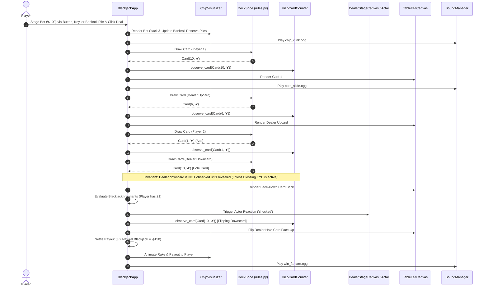
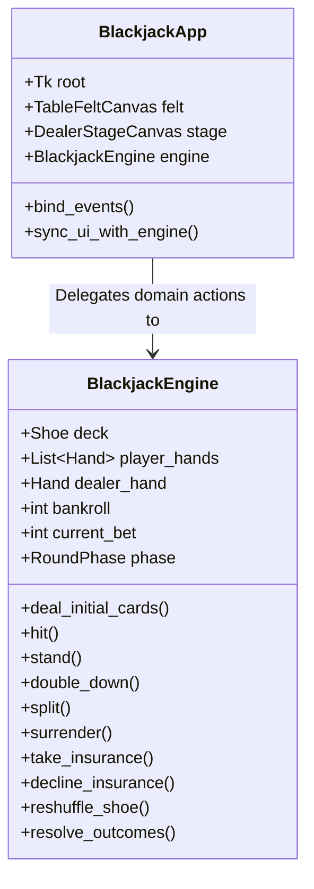
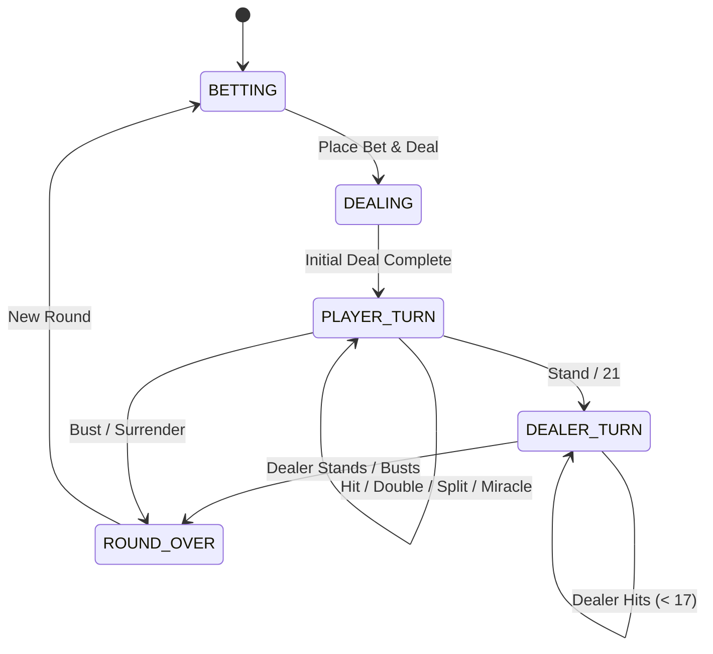

# Blackjack Architecture & CRC Cards Documentation

This document provides a comprehensive structural reference for the **Blackjack** desktop application using **Class-Responsibility-Collaboration (CRC) Cards**, accompanied by system interaction diagrams and an architectural review identifying high-leverage areas of potential improvement.

---

## Table of Contents
1. [Architectural Overview & Subsystem Map](#1-architectural-overview--subsystem-map)
2. [Class-Responsibility-Collaboration (CRC) Cards](#2-class-responsibility-collaboration-crc-cards)
   - [Subsystem A: Core Game Domain & Rules](#subsystem-a-core-game-domain--rules)
   - [Subsystem B: Progression & Haunted Game Modes](#subsystem-b-progression--haunted-game-modes)
   - [Subsystem C: Dealer Puppet Engine & Dialogue Voice](#subsystem-c-dealer-puppet-engine--dialogue-voice)
   - [Subsystem D: Audio, Assets & Theme Configuration](#subsystem-d-audio-assets--theme-configuration)
   - [Subsystem E: Persistence, Records & Achievements](#subsystem-e-persistence-records--achievements)
   - [Subsystem F: Table Felt Canvases & In-Table HUDs](#subsystem-f-table-felt-canvases--in-table-huds)
   - [Subsystem G: Modal Dialogs & Specialized Views](#subsystem-g-modal-dialogs--specialized-views)
   - [Subsystem H: Central Orchestration Controller](#subsystem-h-central-orchestration-controller)
3. [System Collaboration Flows](#3-system-collaboration-flows)
   - [Round Deal & Lifecycle Sequence](#round-deal--lifecycle-sequence)
   - [Card Counting & Hole Card Privacy Invariant](#card-counting--hole-card-privacy-invariant)
   - [Haunted Altar & Supernatural Dialogue Flow](#haunted-altar--supernatural-dialogue-flow)
4. [Critical Review & Areas of Potential Improvement](#4-critical-review--areas-of-potential-improvement)
   - [1. Deconstruction of the `BlackjackApp` God Object](#1-deconstruction-of-the-blackjackapp-god-object)
   - [2. Event-Driven Observer / Pub-Sub Architecture](#2-event-driven-observer--pub-sub-architecture)
   - [3. Formalization of Domain Models & Typing](#3-formalization-of-domain-models--typing)
   - [4. Pure FSM (Finite State Machine) State Transition Validator](#4-pure-fsm-finite-state-machine-state-transition-validator)
   - [5. Decoupling View Presentation from Table Felt State](#5-decoupling-view-presentation-from-table-felt-state)
5. [Summary Matrix of Improvement Recommendations](#5-summary-matrix-of-improvement-recommendations)

---

## 1. Architectural Overview & Subsystem Map

The application is structured into decoupled domain rules, puppet presentation components, procedural audio synthesizers, persistence managers, and a centralized Tkinter GUI controller:

```mermaid
graph TD
    subgraph Core Domain [Core Rules, Engine & Domain]
        rules[rules.py: Card, Hand, HouseRules, RoundPhase, BasicStrategyDecision]
        fsm[state_machine.py: GameStateMachine, InvalidStateTransitionError]
        bus[event_bus.py: EventHub, GameEvent, GameEventType]
        engine[game_engine.py: BlackjackEngine, RoundResult]
        counter[card_counter.py: HiLoCardCounter, MIT_KELLY_UNIT_RAMP]
        trip[tripometer.py: TripometerTracker, TripometerData, HandHistoryRecord]
        bootcamp_dom[counting_bootcamp.py: BootcampCurriculumDAG, BootcampDrillSession]
        tour_dom[tour_domain.py: SalonSpec, SALON_SPECS, evaluate_tour_settlement]
    end

    subgraph Meta Game [Progression & State]
        haunted[haunted_manager.py: HauntedManager, Blessing]
        save[save_manager.py: SaveManager, SaveData, Achievements, BootcampProgress, VenueTourProgress]
    end

    subgraph Audio & Assets [Audio, DisplayProfile & Theme Subsystem]
        audio[audio_assets.py: SoundManager, AssetScaler]
        voice[dialogue_voice_engine.py: AnimaleseVoiceEngine]
        config[config.py: ThemePalette]
        disp[display_profile.py: DisplayProfile, resolve_display_profile, bootstrap_os_display_and_fonts]
    end

    subgraph Dealer Actor [Puppet & Actor Subsystem]
        actor[dealer_actor.py: DealerActor, CharacterProfile]
    end

    subgraph Presentation Canvases [Canvases & In-Table HUDs]
        stage_c[ui_canvases.py: DealerStageCanvas]
        felt_c[ui_canvases.py: TableFeltCanvas]
        chip_c[ui_canvases.py: ChipVisualizer]
        altar_c[ui_canvases.py: HauntedAltarCanvas]
        soul_c[ui_canvases.py: SoulMeterCanvas]
        hud[ui_canvases.py: TableAnnouncementHUD]
        count_hud[card_counting_hud.py: CardCountingHud, FloatingCountBadge]
        bootcamp_ui[counting_bootcamp.py: CountingBootcampFrame, BootcampControlDock]
        tour_ui[venue_tour.py: VenueTourFrame, TourMapRenderer, TourControlDock]
    end

    subgraph Modal Views [Toplevel Dialogs]
        settings_dlg[ui_dialogs.py: SettingsDialog]
        trip_dlg[ui_dialogs.py: TripometerDialog]
        shortcuts_dlg[ui_dialogs.py: ShortcutsDialog]
        splash_dlg[ui_dialogs.py: WelcomeSplashDialog]
        story_dlg[ui_dialogs.py: StoryDialogueDialog]
        draft_dlg[ui_dialogs.py: AngelicDraftDialog]
        wardrobe_dlg[dealer_wardrobe_dialog.py: WardrobeDialog]
        quiz_dlg[card_counting_hud.py: CardCountingQuizDialog]
    end

    subgraph Orchestration [Central Controller]
        app[blackjack.py: BlackjackApp]
    end

    app --> rules
    app --> fsm
    app --> bus
    app --> engine
    app --> counter
    app --> trip
    app --> haunted
    app --> save
    app --> audio
    app --> voice
    app --> actor
    app --> stage_c
    app --> felt_c
    app --> chip_c
    app --> altar_c
    app --> soul_c
    app --> hud
    app --> count_hud

    engine --> rules
    engine --> fsm
    engine --> bus
    engine --> trip
    trip --> rules
    trip --> counter
    trip --> save

    app --> settings_dlg
    app --> trip_dlg
    app --> shortcuts_dlg
    app --> splash_dlg
    app --> story_dlg
    app --> draft_dlg
    app --> wardrobe_dlg
    app --> quiz_dlg

    stage_c --> actor
    actor --> voice
    actor --> audio
```



---

## 2. Class-Responsibility-Collaboration (CRC) Cards

---

### Subsystem A: Core Game Domain & Rules

#### `Card` & Pure Domain Functions ([rules.py](../rules.py#L44))
| Responsibility | Collaboration |
| :--- | :--- |
| **Knows**: Rank (`int` 1--13), suit (`str` `♠`, `♥`, `♦`, `♣`), face value, display label, and asset file name.<br>**Knows**: Special card identity (e.g. Card 13 cursed Card of Skulls, Ace soft value).<br>**Does**: Formats rank string (`"A"`, `"K"`, `"13"`), computes point values, checks blackjack / bust properties, decomposes wagers (`breakdown_chips`) and bankroll reserve stacks (`breakdown_bankroll_piles`) across all 5 chip denominations (\$5, \$25, \$100, \$500, \$1,000 Platinum), and builds/shuffles multi-deck shoes (`build_shoe`). | None (Pure immutable value object / stateless domain functions). |

#### `Hand` ([rules.py](../rules.py#L100))
| Responsibility | Collaboration |
| :--- | :--- |
| **Knows**: Ordered list of `Card` instances, active `bet`, `is_doubled`, `is_split_hand`, `is_surrendered`, `is_stood`, and settled `outcome`.<br>**Does**: Computes dynamic `score`, `is_blackjack`, `is_bust`, `is_soft`, and implements full `list[Card]` sequence protocol compatibility (`len`, indexing, iteration, `append`, `pop`). | Collaborates with [Card](../rules.py#L44) and [BlackjackEngine](../game_engine.py). |

#### `Player` & `Seat` ([rules.py](../rules.py))
| Responsibility | Collaboration |
| :--- | :--- |
| **Knows**: `Player` participant identity (`player_id`, `name`, `bankroll`, `is_bot`).<br>**Knows**: `Seat` physical felt position (`seat_index` 1..3), participant assignment, `main_bet`, `side_bets` (Perfect Pairs, 21+3), active `hands`, `insurance_bet`, `is_active`, `is_resolved`, and total wager exposure (`total_staked`).<br>**Does**: Encapsulates participant allocation and multi-seat table wagering data with zero GUI coupling. | Collaborates with [Hand](../rules.py) and [BlackjackEngine](../game_engine.py). |

#### `RoundPhase` ([rules.py](../rules.py#L84)) & `GameStateMachine` ([state_machine.py](../state_machine.py))
| Responsibility | Collaboration |
| :--- | :--- |
| **Knows**: Enumerated round lifecycles (`BETTING`, `DEALING`, `INSURANCE_PROMPT`, `PLAYER_TURN`, `DEALER_TURN`, `PAYOUT`, `ROUND_OVER`, `GAME_OVER`) and formal legal state transition table.<br>**Does**: Enforces legal state transitions via `GameStateMachine.transition(target_phase)` and raises `InvalidStateTransitionError` on illegal jumps. | Collaborates with [BlackjackEngine](../game_engine.py), [BlackjackApp](../blackjack.py), and [TableAnnouncementHUD](../ui_canvases.py#L645). |

#### `EventHub` & `GameEvent` ([event_bus.py](../event_bus.py))
| Responsibility | Collaboration |
| :--- | :--- |
| **Knows**: Subscribed listener callbacks mapped by `GameEventType` (`CARD_DEALT`, `HOLE_CARD_REVEALED`, `SHOE_SHUFFLED`, `BET_PLACED`, `PHASE_CHANGED`, `PLAYER_ACTION`, `ROUND_CONCLUDED`, `ACHIEVEMENT_UNLOCKED`, `DEALER_SPEECH`, `HAND_RESOLVED`).<br>**Does**: Synchronously publishes typed `GameEvent` payloads to registered observers without coupling domain logic to UI widgets. | Collaborates with [BlackjackEngine](../game_engine.py) and [BlackjackApp](../blackjack.py). |

#### `BlackjackEngine` & `RoundResult` ([game_engine.py](../game_engine.py))
| Responsibility | Collaboration |
| :--- | :--- |
| **Knows**: `player`, `seats` (Seats 1..3), active shoe, `dealer_hand`, `bankroll` (canonical delegation), active turn indices (`active_seat_index`, `active_hand_index`), `state_machine`, and `event_bus`.<br>**Does**: Coordinates multi-seat progression: clockwise dealing (First Base $\to$ Center $\to$ Third Base), inactive seat skipping, split hand traversal, independent surrender without premature round termination, dealer turn skipping on all-seat bust/surrender, and per-hand resolution (`RoundResult` carrying `seat_index`). | Collaborates with [Seat](../rules.py), [Hand](../rules.py), [GameStateMachine](../state_machine.py), and [EventHub](../event_bus.py). |

#### `HouseRules` & `VENUE_PRESETS` ([rules.py](../rules.py))
| Responsibility | Collaboration |
| :--- | :--- |
| **Knows**: Frozen table rule configuration: `preset_name`, `deck_count` (`1`, `2`, `4`, `6`, `8`), `dealer_hits_soft_17` (`S17` vs. `H17`), `blackjack_payout` (`(3, 2)` vs. `(6, 5)`), `double_after_split` (`DAS`), `double_restriction` (`"any"`, `"9_10_11"`, `"10_11"`), `surrender_allowed`, `minimum_bet` (\$5--\$1,000), and `maximum_bet` (`None` or \$25--\$5,000), plus 6 curated casino venue presets (`VENUE_PRESETS`).<br>**Does**: Normalizes and clamps untrusted JSON payloads (`normalized`, `from_dict`), formats compact rule badges (`short_badge`: e.g. `"6D · H17 · 3:2 · DAS · LS"`), estimates baseline house edge (`estimate_house_edge_pct`), computes bankroll-safe minimum bets (`effective_minimum_bet`), clamps main bets (`clamp_main_bet`), and parameterizes `dealer_should_hit`, `calculate_payout`, `can_double_down_hand`, `can_surrender_hand`, `cut_card_threshold`, and `get_basic_strategy_decision`. | Collaborates with [BlackjackEngine](../game_engine.py), [HiLoCardCounter](../card_counter.py), [TripometerTracker](../tripometer.py), [SaveManager](../save_manager.py), [SettingsDialog](../ui_dialogs.py), and [BlackjackApp](../blackjack.py). |

#### `BasicStrategyDecision` ([rules.py](../rules.py#L226))
| Responsibility | Collaboration |
| :--- | :--- |
| **Knows**: Optimal mathematical Blackjack decisions (`HIT`, `STAND`, `DOUBLE`, `SPLIT`, `SURRENDER`).<br>**Does**: Evaluates player hand vs. dealer upcard according to rule-aware casino basic strategy charts (adapting pair splits for `DAS`, soft/hard doubles for `H17` and `double_restriction`, and late surrender for `H17` `15 vs A` / `17 vs A`). | Collaborates with [Card](../rules.py#L44), [HouseRules](../rules.py), [TripometerTracker](../tripometer.py), and [BlackjackApp](../blackjack.py). |

#### `HiLoCardCounter` ([card_counter.py](../card_counter.py#L23))
| Responsibility | Collaboration |
| :--- | :--- |
| **Knows**: Running count (RC), total face-up cards observed, configurable shoe deck count (`1`--`8` decks), remaining deck estimation, Illustrious 18 + Fab 4 surrender index thresholds, and `MIT_KELLY_UNIT_RAMP`.<br>**Knows**: Consumes observed face-up cards and applies standard Hi-Lo card counting weights ($2\text{--}6 \to +1$, $7\text{--}9 \to 0$, $10\text{--}\text{A} \to -1$).<br>**Does**: Computes estimated remaining decks ($\max(0.5, \text{cards} / 52.0)$), converts RC to True Count ($\text{TC} = \text{RC} / \text{Decks}$), calculates rule-aware player mathematical edge (`estimate_player_advantage` / `get_player_advantage`), evaluates `H17`/`LS`-aware index deviations (`evaluate_hand_deviation`), and computes bankroll- and table-limit-aware Kelly wager targets (`get_kelly_bet_target`). | Collaborates with [Card](../rules.py#L44), [HouseRules](../rules.py), [TripometerTracker](../tripometer.py), [CardCountingHud](../card_counting_hud.py#L58), and [BlackjackApp](../blackjack.py). |

#### `TripometerTracker`, `TripometerData` & `HandHistoryRecord` ([tripometer.py](../tripometer.py))
| Responsibility | Collaboration |
| :--- | :--- |
| **Knows**: Cumulative strategy skill counters (`bs_optimal_decisions` / `bs_total_decisions`, `i18_optimal_decisions` / `i18_opportunities`, `kelly_optimal_rounds` / `kelly_total_rounds`), trip net P&L (`trip_net_profit`), and a bounded 50-hand JSON-safe ring buffer (`recent_hands` of `HandHistoryRecord` & `DecisionStepRecord`) with zero Tkinter references.<br>**Does**: Snapshots active `HouseRules` at deal start (`begin_round`), grades Kelly bet sizing within a $\pm 1$-tier tolerance band, evaluates voluntary Hit/Stand/Double/Split/Surrender and affordable Insurance decisions in real time (`record_decision`, `record_insurance_decision`), quarantines supernatural Card 13 / Relic / Hell's Table hands (`mark_supernatural`) without polluting mastery percentages, and commits round summaries atomically on settlement (`finalize_round`). | Collaborates with [HouseRules](../rules.py), [HiLoCardCounter](../card_counter.py), [SaveManager](../save_manager.py), [BlackjackEngine](../game_engine.py), [TripometerDialog](../ui_dialogs.py), and [BlackjackApp](../blackjack.py). |

#### `BootcampCurriculumDAG` & `BootcampDrillSession` ([counting_bootcamp.py](../counting_bootcamp.py))
| Responsibility | Collaboration |
| :--- | :--- |
| **Knows**: 14-node MIT Hi-Lo curriculum DAG (`L0`–`L6` lectures and `S1`–`S7` challenge drills), prerequisite unlock chains, slide decks, prompt distributions, response latencies, and grade rubrics (`S`, `A`, `B`, `C`, `F`).<br>**Does**: Evaluates DAG node statuses (`LOCKED`, `UNLOCKED`, `COMPLETED`), generates deterministic stage drill prompts (Single-Card Tagging, Pair Cancellation, Running Count Stream, Deck Estimation & True Count, Kelly Bet Sizing, Illustrious 18 Index Deviations, and 3-Seat Table Exam), grades submissions, and identifies the primary weakness tag. | Collaborates with [HiLoCardCounter](../card_counter.py#L23), [BootcampProgress](../save_manager.py), and [CountingBootcampFrame](../counting_bootcamp.py). |

#### `SalonSpec` & Venue Tour Domain Functions ([tour_domain.py](../tour_domain.py))
| Responsibility | Collaboration |
| :--- | :--- |
| **Knows**: Immutable 8-Salon progression table (`SALON_SPECS`, \$500 *Training Pit* $\to$ \$150,000 *Sanctum of Light*), `EXORCIST_BOUNTY_AMOUNT` (`\$666`), `TOUR_COORDINATOR_COSTUME` (`julian_monte_carlo`), pure-math `HouseRules` (`preset_id="custom"`), dealer costume & stage backdrop pairings, and Overworld landmark node coordinates.<br>**Does**: Evaluates salon discovery (`get_max_discovered_salon_index`), Standard vs. Ironman node visual states (`get_salon_visual_state`), anti-domino frontier capping (`_is_forgiving_frontier_capped`, `can_select_salon`), `<= 80%` Checkpoint Top-Up eligibility (`can_top_up_forgiving`, `apply_forgiving_top_up`), net-profit settlement promotion & permanent Obsidian Medallion preservation (`evaluate_tour_settlement`), and voluntary Ironman resets (`reset_ironman_run`) with zero Tkinter dependencies. | Collaborates with [HouseRules](../rules.py), [VenueTourProgress](../save_manager.py), [VenueTourFrame](../venue_tour.py), and [BlackjackApp](../blackjack.py). |

---

### Subsystem B: Progression & Haunted Game Modes

#### `HauntedManager` ([haunted_manager.py](../haunted_manager.py#L137))
| Responsibility | Collaboration |
| :--- | :--- |
| **Knows**: Active supernatural phase (`NORMAL`, `CREEP`, `OMEN`, `SNUFFING`, `HELL_TABLE`, `VICTORY`), hand count, candle states (5 candles), Tug-of-War Soul Meter percentage (`0%`--`100%`), active blessings, and per-hand ability flags (`miracle_used_this_hand`, `seraph_used_this_hand`).<br>**Does**: Evaluates game state triggers on round outcomes (win, loss, bust, push, natural).<br>**Does**: Advances progression narrative phases, snuffs candles on lost rounds, injects Card 13 (Cursed Card of Skulls), and triggers Hell's Table when all 5 candles extinguish.<br>**Does**: Manages Angelic Blessing drafts at `50%` and `75%` Soul Meter milestones and enforces per-hand blessing powers (such as `Blessing.SERAPH` auto-banishing and redrawing a busting hit card once per hand). | Collaborates with [Phase](../haunted_manager.py#L28), [Blessing](../haunted_manager.py#L38), [BlessingDetails](../haunted_manager.py#L50), [HauntedAltarCanvas](../ui_canvases.py#L815), [SoulMeterCanvas](../ui_canvases.py#L461), and [BlackjackApp](../blackjack.py). |

#### `Phase` ([haunted_manager.py](../haunted_manager.py#L28))
| Responsibility | Collaboration |
| :--- | :--- |
| **Knows**: The enumeration of haunted progression tiers (`NORMAL`, `CREEP`, `OMEN`, `SNUFFING`, `HELL_TABLE`, `VICTORY`).<br>**Does**: Dictates table visual style, dealer demeanor, HUD switching (swapping `ChipVisualizer` for `SoulMeterCanvas` in `HELL_TABLE`), and cursed card deck injection. | Collaborates with [HauntedManager](../haunted_manager.py#L137) and [BlackjackApp](../blackjack.py). |

#### `Blessing` & `BlessingDetails` ([haunted_manager.py](../haunted_manager.py#L38))
| Responsibility | Collaboration |
| :--- | :--- |
| **Knows**: Blessing ID (`SERAPH`, `EYE`, `SMITE`, `CHERUB`, `TITHE`, `MIRACLE`, `HALLOWED`), human-readable title, icon badge, and gameplay modifier description.<br>**Does**: Supplies metadata for `AngelicDraftDialog` presentation and modifies game rule calculations during rounds (e.g. `SERAPH` bust-card auto-redraw once per hand, `EYE` immediate dealer hole card exposure and count observation, `CHERUB` 22-bust forgiveness, `MIRACLE` manual card banish & redraw). | Collaborates with [AngelicDraftDialog](../ui_dialogs.py#L130) and [HauntedManager](../haunted_manager.py#L137). |

---

### Subsystem C: Dealer Puppet Engine & Dialogue Voice

#### `DealerActor` ([dealer_actor.py](../dealer_actor.py#L133))
| Responsibility | Collaboration |
| :--- | :--- |
| **Knows**: Active dealer identity (`character_id` / `current_character` across all 8 personas: `julian`, `tiffany`, `malphas`, `uriel`, `mortimer`, `selene`, `vladimir`, `dummy`), active costume alias, 7 true de-occluded puppet strata (*shadow*, *torso*, *neck*, *head* mannequin faceplate, isolated per-socket *eyes*, *mouth* visemes, articulated *arms*), independent multi-layer kinematic offsets (`torso_offset`, `head_offset`, `arm_offset`, `eye_gaze_offset`), idle breathing cycle phase, procedural blink countdown, and emotional expression state.<br>**Does**: Loads, caches, and scales multi-layer character PNG sprites.<br>**Does**: Computes breathing offsets, dynamic eye-blink durations, and per-layer kinematic gestures (`set_layer_offsets`, `set_gaze_target`, `reset_kinematics`); selects phonetic mouth visemes during speech (`a`, `o`, `e`, `f`, `talk`, `smirk`, `gasp`).<br>**Does**: Blits composite character layers onto the stage canvas; supplies persona-specific outcome and tactical dialogue (`get_outcome_dialogue`, `get_tactical_dialogue`) and triggers character voice utterances on typewriter dialogue events. | Collaborates with [CharacterProfile](../dealer_actor.py#L33), [AnimaleseVoiceEngine](../dialogue_voice_engine.py#L25), [SoundManager](../audio_assets.py#L140), and [DealerStageCanvas](../ui_canvases.py#L1319). |

#### `CharacterProfile` ([dealer_actor.py](../dealer_actor.py#L33))
| Responsibility | Collaboration |
| :--- | :--- |
| **Knows**: Character display name, lore title, backdrop setting, baseline voice pitch, vocal speed, sound timbre category, unlocked status, and costume aliases.<br>**Does**: Supplies profile metadata used to configure `DealerActor`, `AnimaleseVoiceEngine`, and `WardrobeDialog`. | Collaborates with [DealerActor](../dealer_actor.py#L133) and [WardrobeDialog](../dealer_wardrobe_dialog.py#L28). |

#### `AnimaleseVoiceEngine` ([dialogue_voice_engine.py](../dialogue_voice_engine.py#L25))
| Responsibility | Collaboration |
| :--- | :--- |
| **Knows**: Acoustic parameters per dealer (fundamental frequency $F_0$, harmonics, formant filter frequencies, phonetic viseme map, volume scale).<br>**Does**: Procedurally synthesizes 16-bit mono 44.1 kHz PCM audio in memory with zero external sound files.<br>**Does**: Dynamically inflects pitch (rising `+18%` on `?`, falling `-12%` on `.`, rising `+20%` with `1.20x` amplitude boost on `!`) and plays phonetic audio chirps matching typewriter text animation. | Collaborates with [DealerActor](../dealer_actor.py#L133) and [SoundManager](../audio_assets.py#L140). |

---

### Subsystem D: Audio, Assets & Theme Configuration

#### `SoundManager` ([audio_assets.py](../audio_assets.py#L140))
| Responsibility | Collaboration |
| :--- | :--- |
| **Knows**: Master mute flag, SFX volume, dialogue voice volume, and cached sound effects (`.ogg`).<br>**Does**: Initializes 16-channel polyphonic `pygame.mixer` audio backend with graceful headless fallback; plays card slides, chip clinks, shuffles, bets, rakes, and win/loss fanfares asynchronously without blocking the UI thread. | Collaborates with [BlackjackApp](../blackjack.py) and [SettingsDialog](../ui_dialogs.py#L219). |

#### `AssetScaler` ([audio_assets.py](../audio_assets.py#L28))
| Responsibility | Collaboration |
| :--- | :--- |
| **Knows**: Active `DisplayProfile` integer `art_scale` (`1` or `2`) and `card_scale` (`1.0`, `1.5`, or `2.0`).<br>**Does**: Resolves absolute asset paths across development directories and PyInstaller bundles (`sys._MEIPASS`). Scales icons/UI textures with integer `NEAREST` and playing cards with `1.0x`/`2.0x` `NEAREST` or `1.5x` (`111x160`) `LANCZOS` RGB + binary alpha thresholding (`a >= 128`) and `#1e1e1e` border re-stroking. | Collaborates with [DisplayProfile](../display_profile.py), [BlackjackApp](../blackjack.py), and all presentation canvases. |

#### `DisplayProfile` & OS Display Bootstrap ([display_profile.py](../display_profile.py))
| Responsibility | Collaboration |
| :--- | :--- |
| **Knows**: Discrete display profiles (`hd_720p`, `deck_800p`, `fhd_1080p`, `qhd_1440p`, `uhd_4k`), OS environment probe (`DisplayEnvironmentProbe`: physical monitor geometry, usable desktop work area, Linux/X11/Wayland/SteamOS `SteamDeck=1` flags), and font/DPI diagnostics (`DisplayDiagnostics`).<br>**Does**: Resolves exact integer `art_scale` (`1` or `2`), `card_scale` (`1.0`, `1.5`, or `2.0`), `pit_max_width`, and stage pillar widths (`min(width_tier, height_tier)` in Fullscreen; `1280x800` default stepping down to `1280x720` when work-area height `< 840px`); registers Windows Per-Monitor v2 DPI awareness and Linux `libfontconfig` `.ttf` fonts before `Tk()`; locks `tk scaling 1.0`; and configures transient `-type dialog` modals. | Collaborates with [SaveData](../save_manager.py), [AssetScaler](../audio_assets.py), [pixel_ui](../pixel_ui.py), [ui_layout](../ui_layout.py), [SettingsDialog](../ui_dialogs.py), and [BlackjackApp](../blackjack.py). |

#### `KeyboardIconLoader` ([audio_assets.py](../audio_assets.py#L210))
| Responsibility | Collaboration |
| :--- | :--- |
| **Knows**: Curated Kenney keyboard and mouse UI sprite assets.<br>**Does**: Loads, resizes, and caches visual keyboard shortcut badges for in-game HUDs and shortcut overlay dialogs. | Collaborates with [ShortcutsDialog](../ui_dialogs.py#L555). |

#### `ThemePalette` ([config.py](../config.py#L65))
| Responsibility | Collaboration |
| :--- | :--- |
| **Knows**: Centralized UI color tokens (felt colors, button states, stage backdrops, text typography, accent gold, border highlights) and chip denomination styling (\$5 White, \$25 Green, \$100 Black, \$500 Purple, \$1,000 Platinum).<br>**Does**: Standardizes color palette across Classic, Haunted, Hell's Table, and Celestial Victory environments. | Collaborates with all UI Canvases, Dialogs, and [BlackjackApp](../blackjack.py). |

---

### Subsystem E: Persistence, Records & Achievements

#### `SaveManager` ([save_manager.py](../save_manager.py#L182))
| Responsibility | Collaboration |
| :--- | :--- |
| **Knows**: Active save file path (`blackjack_save.json`), fallback paths, and in-memory `SaveData` payload.<br>**Does**: Safely serializes and deserializes player records, persistent session bankroll (`current_bankroll`), career telemetry (`lifetime_wagered`, `bankruptcies`, `total_bailout_funds`), active `HouseRules` (`house_rules`), persistent `TripometerData` (`tripometer`), unlocked dealers, unlocked costumes, card counting test streaks and telemetry (`counting_quizzes_taken`, `counting_quizzes_correct`, `counting_accuracy_pct`), and all achievement badges (including `shoe_whisperer`, `count_capitalist`, `pair_perfectionist`, and `poker_face`). Gracefully recovers from corrupted JSON files and untrusted payloads. | Collaborates with [SaveData](../save_manager.py#L140), [HouseRules](../rules.py), [TripometerData](../tripometer.py), [Achievements](../save_manager.py#L65), [HighScores](../save_manager.py#L26), and [BlackjackApp](../blackjack.py). |

#### `SaveData`, `Achievements`, `HighScores` ([save_manager.py](../save_manager.py#L26))
| Responsibility | Collaboration |
| :--- | :--- |
| **Knows**: Persistent player stats: session bankroll (`current_bankroll`), total hands played, hands won/lost/pushed, natural blackjacks, peak bankroll, career wagering volume (`lifetime_wagered`), house credit bailouts (`bankruptcies`, `total_bailout_funds`), net profit calculation, Hell's Table clears, card counting quiz streaks and accuracy telemetry, side bet statistics (`side_bets_played`, `side_bets_won`, `biggest_side_bet_win`), and all 12 unlocked achievements.<br>**Does**: Provides validated dataclass structures for JSON serialization. | Collaborates with [SaveManager](../save_manager.py#L182). |

---

### Subsystem F: Table Felt Canvases & In-Table HUDs

#### `DealerStageCanvas` ([ui_canvases.py](../ui_canvases.py#L1319))
| Responsibility | Collaboration |
| :--- | :--- |
| **Knows**: Stage backdrop image, 3D horizon rail dimensions, dynamic sconce lighting timers, dealer speech bubble bounds, and typewriter text position.<br>**Does**: Renders atmospheric room environment and composite dealer puppet; animates flickering candles and handles interactive speech bubble typewriter text streaming. | Collaborates with [DealerActor](../dealer_actor.py#L133), [AnimaleseVoiceEngine](../dialogue_voice_engine.py#L25), and [BlackjackApp](../blackjack.py). |

#### `TableFeltCanvas` ([ui_canvases.py](../ui_canvases.py#L1675))
| Responsibility | Collaboration |
| :--- | :--- |
| **Knows**: Casino table boundaries, dynamic rule arc text (`BLACKJACK PAYS 3 TO 2` vs `6 TO 5`, `DEALER MUST STAND ON ALL 17s` vs `HITS SOFT 17`), bounded `OrderedDict` `maxsize=2` 6-tuple `_felt_cache` (`(theme, width, height, art_scale, payout_ratio, dealer_hits_soft_17)`), pure-Pillow `128x128` seamless baize grain tile + `64x48` radial vignette, child widget background slice coordinates (`sync_children_felt()`), and multi-seat table felt spots (Seats 1..3) centered in widescreen `resolve_pit_bounds`.<br>**Does**: Draws zero-NumPy baize felt texture (100% parity between source runs and PyInstaller builds), authentic rule-synchronized table markings, 3 crescent betting spots with horizontal flanking side bets and 3D chip stacks (via `ui_chip_renderer.py`), active turn glowing halos, and canvas-level geometric click dispatching (left-click stage, right-click clear) without event bubbling. In 1-seat mode, cleanly suppresses felt spots so the baize remains pristine. | Collaborates with [BlackjackApp](../blackjack.py), [DisplayProfile](../display_profile.py), [HouseRules](../rules.py), [ui_chip_renderer](../ui_chip_renderer.py), and [ui_layout](../ui_layout.py). |

#### `ChipRenderer` ([ui_chip_renderer.py](../ui_chip_renderer.py))
| Responsibility | Collaboration |
| :--- | :--- |
| **Knows**: Stateless 2.5D casino chip cylinder geometry, edge stripes, face insets, denomination styles, and drop shadow coordinates.<br>**Does**: Renders individual 2.5D casino chips and vertical 3D chip stacks across both `ChipVisualizer` (1-seat bankroll) and `TableFeltCanvas` (3-seat betting spots). | Collaborates with [TableFeltCanvas](../ui_canvases.py) and [ChipVisualizer](../ui_canvases.py). |

#### `ChipVisualizer` ([ui_canvases.py](../ui_canvases.py#L59))
| Responsibility | Collaboration |
| :--- | :--- |
| **Knows**: Current wager denomination breakdown and player bankroll reserve piles across all 5 denominations (\$5, \$25, \$100, \$500, \$1,000 Platinum), 3D stack offsets, and pile bounding boxes.<br>**Does**: Visually renders realistic layered casino chip stacks in the top Betting Spot and bottom interactive Bankroll Reserve Tray (`render_bankroll_piles`); handles direct click-to-bet on reserve piles (`trigger_pile_click`); executes non-blocking chip slide and rake animations. | Collaborates with [BlackjackApp](../blackjack.py) and [SoundManager](../audio_assets.py#L140). |

#### `TableAnnouncementHUD` ([ui_canvases.py](../ui_canvases.py#L645))
| Responsibility | Collaboration |
| :--- | :--- |
| **Knows**: Active table banner messages, status pill labels, and banner typography.<br>**Does**: Presents non-intrusive in-felt status announcements (`"BLACKJACK! 3:2"`, `"BLACKJACK! 6:5"`, `"DEALER BUSTS"`, `"SERAPH'S GRACE"`, `"MIRACLE DRAW"`) with fade/slide animations and click-to-dismiss. | Collaborates with [BlackjackApp](../blackjack.py). |

#### `HauntedAltarCanvas` ([ui_canvases.py](../ui_canvases.py#L815))
| Responsibility | Collaboration |
| :--- | :--- |
| **Knows**: Altar geometry, 5 candle coordinates, flame particle timers, gravestone elevation offsets, and smoke animations.<br>**Does**: Animates atmospheric burning candle flames; triggers candle snuffing animations on player losses; renders 2.5D gravestones rising from the table felt. | Collaborates with [HauntedManager](../haunted_manager.py#L137) and [BlackjackApp](../blackjack.py). |

#### `SoulMeterCanvas` ([ui_canvases.py](../ui_canvases.py#L461))
| Responsibility | Collaboration |
| :--- | :--- |
| **Knows**: Current Tug-of-War Soul Meter percentage (`0%`--`100%`), target display value, particle glow effects, and milestone markers (`50%`, `75%`).<br>**Does**: Replaces `ChipVisualizer` in the bottom-right table dock during `Phase.HELL_TABLE` to render the interactive Tug-of-War Soul Meter HUD on the felt. | Collaborates with [HauntedManager](../haunted_manager.py#L137) and [BlackjackApp](../blackjack.py). |

#### `CardCountingHud` & `FloatingCountBadge` ([card_counting_hud.py](../card_counting_hud.py#L20))
| Responsibility | Collaboration |
| :--- | :--- |
| **Knows**: Hi-Lo Running Count, True Count, remaining shoe decks (`4.0` default), player mathematical Edge %, Assisted vs. Drill Challenge Mode state (`drill_mode`), visibility toggle state, and floating count badge coordinates.<br>**Does**: Draws compact felt-embedded count HUD; masks live RC/TC/Edge % readouts with `???` during Drill Challenge Mode until verified via quiz; animates transient floating text badges (`+1`, `-1`, `0`) above dealt cards; provides betting spread advice and a `🎓 Bootcamp` launcher button. | Collaborates with [HiLoCardCounter](../card_counter.py#L23), [CountingBootcampFrame](../counting_bootcamp.py), and [BlackjackApp](../blackjack.py). |

#### `CountingBootcampFrame`, `BootcampCanvasRenderer` & `BootcampControlDock` ([counting_bootcamp.py](../counting_bootcamp.py), [bootcamp_domain.py](../bootcamp_domain.py))
| Responsibility | Collaboration |
| :--- | :--- |
| **Knows**: Active Bootcamp sub-view (`teacher_intro`, `map`, `lecture`, `challenge`, `report_card`), focused DAG node index, active `BootcampDrillSession`, tracked `.after()` timer handles, and bottom dock button definitions.<br>**Does**: Separates pure domain curriculum/drill state ([`BootcampCurriculumDAG`](../bootcamp_domain.py), [`BootcampDrillSession`](../bootcamp_domain.py)), stateless 2.5D baize drawing (`1000x390` at `1x`, `2000x780` at `2x` aligned 1:1 with `DealerStageCanvas` via [`BootcampCanvasRenderer`](../counting_bootcamp.py)), bottom dock controls ([`BootcampControlDock`](../counting_bootcamp.py)), and navigation/timer orchestration ([`CountingBootcampFrame`](../counting_bootcamp.py)). Swaps cleanly into `row=2` (felt area) and `row=3` (mahogany control dock) while preserving `DealerStageCanvas` (`row=0`) so the live dealer acts as instructor. | Collaborates with [BootcampCurriculumDAG](../bootcamp_domain.py), [ChipRenderer](../ui_chip_renderer.py), [MahoganyRailCanvas](../ui_canvases.py), [SaveManager](../save_manager.py#L182), and [BlackjackApp](../blackjack.py). |

#### `VenueTourFrame`, `VenueTourCanvasRenderer` & `TourControlDock` ([venue_tour.py](../venue_tour.py), [tour_domain.py](../tour_domain.py))
| Responsibility | Collaboration |
| :--- | :--- |
| **Knows**: Focused Overworld salon index (`0`–`7`), cached zone gradients, `ImageTk.PhotoImage` references bound to `master=self.canvas`, single-source geometric `node_hit_boxes`, and bottom `MahoganyRailCanvas` dock buttons (`Enter Salon [Enter]`, `Mode: Standard` / `Mode: Ironman`, `Top Up` / `Reset Run [\$500]`, `Free Play [Esc]`).<br>**Does**: Mounts the `1000x390` (`2000x780` at `2x`) 2.5D Super Mario World Overworld Map into `row=2` and `TourControlDock` into `row=3` aligned 1:1 beneath Tour Coordinator *Julian* (`row=0`); renders 8 procedural 2.5D pixel-art landmarks, darkened `'???'` silhouettes, velvet ropes on promoted salons, and dual Gold (`★`) & Obsidian (`♦`) casino chip medallions via `ui_chip_renderer.py`. | Collaborates with [SalonSpec](../tour_domain.py), [ChipRenderer](../ui_chip_renderer.py), [MahoganyRailCanvas](../ui_canvases.py), [SaveManager](../save_manager.py), and [BlackjackApp](../blackjack.py). |

---

### Subsystem G: Two-Tier In-Window Menus & Floating Gameplay Overlays (`InWindowScreenHost`)

#### `InWindowScreenHost` & `InWindowConfirmModal` ([ui_dialogs.py](../ui_dialogs.py))
| Responsibility | Collaboration |
| :--- | :--- |
| **Knows**: Host root `Tk` window, active `DisplayProfile` (`art_scale`, `window_wh`, `pit_max_width`), `menu_scale` (`2` on `>= 1800x1000` `1080p`/`1440p`/`4K`, `1` on `720p`/`800p`), `is_compact_2x` (`True` on `1080p`), optional `overlay_wh` / `overlay_rely`, `_active_inwindow_screens` modal stack, `<Configure>` resize listener, and active confirmation hooks (`_active_confirm_cancel`, `_active_confirm_key`).<br>**Does**: Mounts all screens directly inside the root `Tk` window so zero external X11/Win32 `Toplevel` or `messagebox` windows ever spawn on SteamOS Gamescope: **Tier 1 (`overlay_wh=None`)** fills `100%` of the viewport for zero-scroll paged menus with true `2x` integer portraits/icons/fonts on Full-HD+; **Tier 2 (`overlay_wh=(w, h)`)** floats centered strictly within the `CardTable` felt band (clamped below `HorizonRail` and above `MahoganyRail`, temporarily hiding empty `0`-card score plaques) with `grab_set()` pointer confinement. Provides `InWindowConfirmModal.ask_yes_no(...)` with `#ffd700` `<Left>`/`<Right>`/D-pad focus routing. | Collaborates with [BlackjackApp](../blackjack.py), [DisplayProfile](../display_profile.py), and all Subsystem G screens. |

#### `SettingsDialog` ([ui_dialogs.py](../ui_dialogs.py))
| Responsibility | Collaboration |
| :--- | :--- |
| **Knows**: Full-screen two-tab configuration state (`[1] Table, Audio & Records` and `[2] Casino House Rules & Limits`): audio/voice toggles, display profile/card-scale/fullscreen controls, Play Mode & Table Seats, 6-metric Career KPI grid + clickable Quick Salon Launchers, 6 curated Casino Venue Presets (`VENUE_PRESETS`), custom `HouseRules` parameters, and live/draft Estimated House Edge % badge.<br>**Does**: Renders 2-column widescreen layouts on both tabs (`1x` at `720p`/`800p`, `2x` crunchy integer fonts at `1080p`/`1440p`/`4K`) with zero vertical scrolling, highlights unsaved rule drafts (`[Enter]` to apply), blocks rule mutations mid-hand, and guards save resets via a floating `InWindowConfirmModal`. | Collaborates with [InWindowScreenHost](../ui_dialogs.py), [HouseRules](../rules.py), [DisplayProfile](../display_profile.py), [SoundManager](../audio_assets.py#L140), and [BlackjackApp](../blackjack.py). |

#### `TripometerDialog` ([ui_dialogs.py](../ui_dialogs.py))
| Responsibility | Collaboration |
| :--- | :--- |
| **Knows**: Live `TripometerTracker` summary metrics (Basic Strategy %, Illustrious 18 %, Kelly Bet Sizing %, Trip Net P&L, `All Hands` vs `Mistakes Only` filter state, and `current_page` / `page_size` pagination state) across the 50-hand audit log (`HandHistoryRecord`).<br>**Does**: Renders a full-viewport zero-scroll strategy audit screen (`📊 Trip` wing button or `T` key) with 3 full-width beveled Grade Plaques (`Round9x13` `%`), computed `(total)` hand scores, controller-friendly `◀ Prev [◄]` / `Page X / Y` / `Next [►] ▶` pagination (`3` hands/page on `720p`, `4` hands/page on `800p`/`1080p`/`1440p`/`4K`), and `2:1` paired `✔ Done` + `InWindowConfirmModal`-guarded `🗑 Reset Trip Stats` footer controls. | Collaborates with [InWindowScreenHost](../ui_dialogs.py), [TripometerTracker](../tripometer.py), and [BlackjackApp](../blackjack.py). |

#### `MultiSeatInsuranceDialog` ([ui_dialogs.py](../ui_dialogs.py))
| Responsibility | Collaboration |
| :--- | :--- |
| **Knows**: Insurable seats (active multi-seat positions when dealer shows an Ace), required insurance bets ($\frac{1}{2}$ main bet per seat), focused seat card index, and player bankroll.<br>**Does**: Mounts as a compact centered floating banner (`overlay_wh=(800, 265)`) over the live table so the dealer's Ace above and all 3 dealt seat hands below remain visible, rendering 3 horizontal Seat Toggle Cards (`[3] Left`, `[2] Center`, `[1] Right`) controlled via `[1]`/`[2]`/`[3]`, `[◄/► + Space]`, `[A/Y]` Insure All, `[Enter]` Confirm, and `[Esc/N]` Decline. | Collaborates with [InWindowScreenHost](../ui_dialogs.py), [BlackjackApp](../blackjack.py), and [BlackjackEngine](../game_engine.py). |

#### `ShortcutsDialog` ([ui_dialogs.py](../ui_dialogs.py))
| Responsibility | Collaboration |
| :--- | :--- |
| **Knows**: All keyboard and mouse shortcut mappings across Gameplay, Wagering (`1`--`5` for \$5--\$1,000 chips, `Left`/`Right` for 3-Seat focus, Left/Right Mouse spot clicks), Card Counting, Strategy Tripometer (`T`), and System controls (`Shift+W`, `Shift+H`, `F1`/`?`).<br>**Does**: Renders a full-screen zero-scroll two-column controls reference (`[1] Gameplay & Betting` and `[2] System, Trainer & Modes`) with zebra row striping, `1x`/`2x` Kenney graphical keycap & mouse sprites (`m6x11plus`), `?`/`F1` toggle-close parity, and a bottom `✔ Return to Table` bar. | Collaborates with [InWindowScreenHost](../ui_dialogs.py), [KeyboardIconLoader](../audio_assets.py#L210), and [BlackjackApp](../blackjack.py). |

#### `WelcomeSplashDialog` ([ui_dialogs.py](../ui_dialogs.py))
| Responsibility | Collaboration |
| :--- | :--- |
| **Knows**: Three Play Modes (`[1] Casual Mode`, `[2] Casino Betting`, `[3] Strategy Trainer`), active croupier greeting banner (`112x112` `1x` or `224x224` `2x` bust), and startup `Remember my preference` (`[R]`) state.<br>**Does**: Renders a full-screen zero-scroll 3-column horizontal mode showcase on startup (or via Settings) with tactile `[✓ SELECTED]` / `[Click to Select]` pills, `[1]`/`[2]`/`[3]`, `Left`/`Right`, and click-selected-to-launch support. | Collaborates with [InWindowScreenHost](../ui_dialogs.py) and [BlackjackApp](../blackjack.py). |

#### `StoryDialogueDialog` ([ui_dialogs.py](../ui_dialogs.py))
| Responsibility | Collaboration |
| :--- | :--- |
| **Knows**: Narrative story script branches, speaker character, portraits, and proceed callbacks.<br>**Does**: Mounts as a centered floating theatrical cutscene banner (`overlay_wh=(740, 215)` / `(760, 235)`, `overlay_rely=0.57`) over the lower felt, suppressing duplicate speaker portraits and temporarily hiding stage speech bubbles + tails when the speaker (`malphas`) is already live on `DealerStageCanvas`. | Collaborates with [InWindowScreenHost](../ui_dialogs.py), [DealerActor](../dealer_actor.py#L133), and [BlackjackApp](../blackjack.py). |

#### `AngelicDraftDialog` ([ui_dialogs.py](../ui_dialogs.py))
| Responsibility | Collaboration |
| :--- | :--- |
| **Knows**: 3 randomly selected Blessing cards drawn from the active pool at `50%` and `75%` Soul Meter milestones, plus `focused_idx` D-pad/arrow selection.<br>**Does**: Mounts as a centered floating 3-column celestial relic draft overlay (`overlay_wh=(744, 348)`) inside the `CardTable` felt band clear of `HorizonRail` and `SOUL WAGER`, rendering `2x`-zoomed relic icons in recessed cyan shrines with `[◄ / ► + Enter]`, `<Tab>`, `[1]`--`[3]`, and click selection. | Collaborates with [InWindowScreenHost](../ui_dialogs.py), [HauntedManager](../haunted_manager.py#L137), and [BlackjackApp](../blackjack.py). |

#### `WardrobeDialog` ([dealer_wardrobe_dialog.py](../dealer_wardrobe_dialog.py))
| Responsibility | Collaboration |
| :--- | :--- |
| **Knows**: All 8 dealer character profiles, unlocked statuses, unlock achievement criteria, costume-specific flavor quotes (`COSTUME_VOICE_QUOTES`), 14 Hall of Fame achievement plaques across 3 thematic pages (`HOF_PAGE_CONFIG`), and the 8-Salon Venue Tour Medallion Showcase.<br>**Does**: Renders a full-screen zero-scroll two-tab salon (`[1] Wardrobe Closet` with paged `2x2` `DealerCardPanel` cards using `224x224` `2x` crunchy portraits & `2x` pixel fonts on `1080p`/`1440p`/`4K`, live costume quotes, and `[Q]`/`[E]`/`[V]` hotkeys; `[2] Hall of Fame & Trophies` with telemetry banner, paged `3x2` plaques, and the `4x2` 8-Salon Tour Medallion Showcase on Page 3). | Collaborates with [InWindowScreenHost](../ui_dialogs.py), [CharacterProfile](../dealer_actor.py#L33), [DealerActor](../dealer_actor.py#L133), [SaveManager](../save_manager.py#L182), and [BlackjackApp](../blackjack.py). |

#### `CardCountingQuizDialog` ([card_counting_hud.py](../card_counting_hud.py))
| Responsibility | Collaboration |
| :--- | :--- |
| **Knows**: Current ground-truth Running Count (RC) / True Count (TC) and Illustrious 18 deviation spots held by [HiLoCardCounter](../card_counter.py#L23), stepper values (`rc_val` $\pm 1$, `tc_val` $\pm 0.5$), `active_count_field` (`"rc"` vs. `"tc"`), `focused_deviation_idx`, and player's streak count.<br>**Does**: Mounts as a centered floating Count Check & Deviation Check quiz card (`overlay_wh=(680, 395)`) below `HorizonRail` using `-32` chunky `−`/`+` steppers + `Round9x13` digital readouts on Tab 1 and `#ffd700` D-pad-navigable choice frames on Tab 2, while temporarily masking `Assisted` `CardCountingHud` readouts to prevent open-book answer leaks. | Collaborates with [InWindowScreenHost](../ui_dialogs.py), [HiLoCardCounter](../card_counter.py#L23), [SaveManager](../save_manager.py#L182), and [BlackjackApp](../blackjack.py). |

---

### Subsystem H: Central Orchestration Controller

#### `BlackjackApp` ([blackjack.py](../blackjack.py#L155))
| Responsibility | Collaboration |
| :--- | :--- |
| **Knows**: Application version (`__version__ = "1.6.0"`), Tkinter root and widget tree; active deck shoe, player hand(s), dealer hand, active split hand index; chip bankroll and active bets; `round_phase` (`RoundPhase`), dealing timers, and re-entrancy flags (`_dealing`, `_round_over`).<br>**Does**: Coordinates initial GUI layout and dynamic scaling.<br>**Does**: Handles user input (keyboard shortcuts, buttons, interactive bankroll chip piles); drives the dealing animation sequence; resolves round outcomes and payouts (\$5, \$25, \$100, \$500, \$1,000 chip math); updates score displays and synchronizes table HUDs (`ChipVisualizer` vs. `SoulMeterCanvas`), puppet expressions, and persistence saves. | Collaborates with **ALL** subsystems (Domain rules, Card counter, Haunted manager, Save manager, Sound manager, Puppet actor, Canvases, and Dialogs). |

---

## 3. System Collaboration Flows

### Round Deal & Lifecycle Sequence



### Card Counting & Hole Card Privacy Invariant

A critical architectural invariant in the application is the **Dealer Hole Card Privacy Invariant**:
- In casino blackjack, the dealer's facedown downcard must never impact the running count before it is legitimately exposed.
- `HiLoCardCounter.observe_card()` is invoked for player cards and the dealer's *upcard* on initial deal.
- The dealer hole card is only supplied to `HiLoCardCounter` when `_reveal_dealer_hole_card()` executes at the start of the dealer's turn, upon early round conclusion (such as immediate player natural or bust), or immediately on initial deal if `Blessing.EYE` (*Eye of Providence*) deals the hole card face-up (`_hole_card_observed = True`).
- Subsequent dealer hit cards drawn during `_dealer_step()` are also immediately observed via `_observe_card_face_up()`.

### Haunted Altar & Supernatural Dialogue Flow

When playing in Haunted Mode:
1. `BlackjackApp.new_game()` invokes `HauntedManager.advance_hand()`.
2. As `HauntedManager` transitions phases (`NORMAL` $\to$ `CREEP` $\to$ `OMEN` $\to$ `SNUFFING` $\to$ `HELL_TABLE` $\to$ `VICTORY`):
   - Table felt color tokens update via `ThemePalette`.
   - `DealerStageCanvas` switches backdrop and prompts `DealerActor` to adopt corresponding personas (`julian` $\to$ `malphas` $\to$ `uriel`) and supernatural dialogue lines.
   - `AnimaleseVoiceEngine` shifts fundamental frequency and timbre parameters.
3. On round loss in `Phase.SNUFFING`:
   - `HauntedManager.on_round_outcome()` extinguishes a candle flame (`5` $\to$ `0`).
   - `HauntedAltarCanvas` plays flame extinguish particle effects and raises a 2.5D gravestone.
   - When the 5th candle is snuffed (`candles_remaining == 0`), `_conclude_round()` detects the transition into `Phase.HELL_TABLE`, invokes `_trigger_hell_table()`, hides `ChipVisualizer`, and grids `SoulMeterCanvas` (the 2.5D Tug-of-War Soul Meter) in the bottom-right dock.

---

## 4. Architectural Evolution & Implemented Improvements

The 5 architectural improvements identified during CRC analysis have been fully implemented, verified via lower-level modular unit tests, and integrated into `BlackjackApp`:

---

### 1. Deconstruction of the `BlackjackApp` God Object

#### Current State
[blackjack.py](../blackjack.py) spans **~4,000 lines of code**. The `BlackjackApp` class functions as a central controller that manages:
- GUI layout and window management.
- Raw deck state (`self.deck`, `self.deck_count`).
- Betting rules, bankroll math, and payout resolution.
- Hand splitting (`self.player_hands`, `self.hand_bets`, `self.active_hand_index`).
- Timer animation callbacks (`self._deal_timer_id`, `self._dealer_timer_id`).
- Keyboard shortcuts and button bindings.

#### Implemented Architecture: Split into Headless Engine & GUI Adapter
Extracted stateful round orchestration into an independent, zero-GUI `BlackjackEngine` in `game_engine.py` that builds on top of `rules.py`:



*Benefit & Verification*: Full multi-hand round sequences are 100% testable in headless isolation without instantiating a `tkinter.Tk` root via `tests/test_game_engine.py` (9 tests), and end-to-end integration is verified via `tests/test_architectural_integration.py`.

---

### 2. Event-Driven Observer / Pub-Sub Architecture

#### Implemented Architecture: Internal Event Bus (`EventHub`)
Subsystems communicate via a decoupled, synchronous pub-sub event bus in `event_bus.py`:

```python
# Event definitions
class GameEventType(Enum):
    CARD_DEALT = "card_dealt"
    ROUND_RESOLVED = "round_resolved"
    BET_COMMITTED = "bet_committed"
    HAND_SPLIT = "hand_split"
    INSURANCE_TAKEN = "insurance_taken"
    INSURANCE_DECLINED = "insurance_declined"
    SHOE_RESHUFFLED = "shoe_reshuffled"

# Example decoupled subscribers
event_hub.subscribe(GameEventType.CARD_DEALT, lambda evt: sound_manager.play("card_slide"))
event_hub.subscribe(GameEventType.CARD_DEALT, lambda evt: card_counter.observe_card(evt.payload["card"]))
event_hub.subscribe(GameEventType.ROUND_RESOLVED, lambda evt: save_manager.record_hand(evt))
```

*Benefit & Verification*: Eliminates cascading cross-calls when adding new visual effects, sound accents, or achievements. Verified via `tests/test_event_bus.py` and `tests/test_architectural_integration.py`.

---

### 3. Formalization of Domain Models & Typing

#### Implemented Architecture: Dedicated `Hand` Class
Cards, bets, and status are encapsulated into a first-class `Hand` domain object in `rules.py`:

```python
@dataclass
class Hand:
    cards: list[Card] = field(default_factory=list)
    bet: int = 0
    is_doubled: bool = False
    is_surrendered: bool = False
    is_settled: bool = False
    outcome: Optional[str] = None

    @property
    def score(self) -> int:
        return score_hand(self.cards)

    @property
    def is_blackjack(self) -> bool:
        return len(self.cards) == 2 and self.score == 21

    @property
    def is_bust(self) -> bool:
        return self.score > 21
```

*Benefit & Verification*: Replaces parallel lists with first-class `list[Hand]`. Implements standard sequence protocols (`len`, `getitem`, `iter`, `append`, `pop`, `clear`) guaranteeing 100% backward compatibility with legacy card lists. Verified via `tests/test_hand.py` (5 tests) and `tests/test_architectural_integration.py`.

---

### 4. Pure FSM (Finite State Machine) State Transition Validator

#### Implemented Architecture: Formal State Machine Transitions (`GameStateMachine`)
Round phase flow is governed by a pure, deterministic state machine in `state_machine.py`:



*Benefit & Verification*: Validates all state transitions through a strict transition matrix, raising `InvalidStateTransitionError` on illegal actions. Verified via `tests/test_state_machine.py` (8 tests) and `tests/test_architectural_integration.py`.

---

### 5. Decoupling View Presentation from Table Felt State

#### Implemented Architecture: Unified `TableFeltCanvas` Multi-Layer Pipeline
Consolidated card rendering, table accessories, and acrylic fixtures into standardized coordinate layers on `TableFeltCanvas`:
- **Layer 1: Table Furniture & Fixtures**: 2.5D beveled acrylic dealing shoe tray with dynamic card depth/penetration visualization and acrylic discard rack (`draw_shoe_tray`, `draw_discard_rack`, `update_shoe_penetration`).
- **Layer 2: Betting Areas & Markings**: Procedural felt texture generation, bet ring ellipses, and dynamic felt theme synchronization.
- **Layer 3: Canvas Card Sprites & Motion**: Direct canvas card sprite rendering with pixel translation and card clearance (`draw_card_sprite`, `move_card_sprite`, `clear_card_sprites`).
- **Layer 4: HUD & Accessories**: Floating count badges, animated table announcement banners, and Haunted Altar accessories.

*Benefit & Verification*: Standardizes clean canvas z-ordering across display scaling modes. Verified via `tests/test_table_felt.py` (10 tests) and `tests/test_architectural_integration.py`.

---

## 5. Summary Matrix of Architectural Implementations

| Implementation | Scope / Module | Status | Verification Suite |
| :--- | :--- | :---: | :--- |
| **1. Headless `BlackjackEngine`** | [game_engine.py](../game_engine.py) | **Completed** | [`tests/test_game_engine.py`](../tests/test_game_engine.py) |
| **2. Internal Event Bus (`EventHub`)** | [event_bus.py](../event_bus.py) | **Completed** | [`tests/test_event_bus.py`](../tests/test_event_bus.py) |
| **3. First-Class `Hand` Domain Model** | [rules.py](../rules.py#L82) | **Completed** | [`tests/test_hand.py`](../tests/test_hand.py) |
| **4. Pure `GameStateMachine` (FSM)** | [state_machine.py](../state_machine.py) | **Completed** | [`tests/test_state_machine.py`](../tests/test_state_machine.py) |
| **5. `TableFeltCanvas` Multi-Layer Pipeline** | [ui_canvases.py](../ui_canvases.py#L1737) | **Completed** | [`tests/test_table_felt.py`](../tests/test_table_felt.py) & [`tests/test_architectural_integration.py`](../tests/test_architectural_integration.py) |
| **6. Card Counting Monte-Carlo Simulation** | [tools/test_counting_simulation.py](../tools/test_counting_simulation.py) | **Completed** | 10,000 deals verified in `tools/test_counting_simulation.py` |
| **7. Configurable `HouseRules` & Venue Presets** | [rules.py](../rules.py), [game_engine.py](../game_engine.py), [ui_dialogs.py](../ui_dialogs.py) | **Completed** | [`tests/test_house_rules.py`](../tests/test_house_rules.py) & [`tests/test_house_rules_and_tripometer_gui.py`](../tests/test_house_rules_and_tripometer_gui.py) |
| **8. Persistent Strategy Tripometer (`TripometerTracker`)** | [tripometer.py](../tripometer.py), [ui_dialogs.py](../ui_dialogs.py), [save_manager.py](../save_manager.py) | **Completed** | [`tests/test_tripometer.py`](../tests/test_tripometer.py) & [`tests/test_house_rules_and_tripometer_gui.py`](../tests/test_house_rules_and_tripometer_gui.py) |
