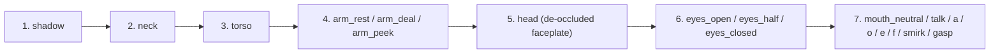

# Dealer Costume Authoring Guide & 19-Layer Puppet Pipeline

This document specifies the architecture, coordinate-space math, pixel-art generation standards, background/armpit defringing algorithms, facial/viseme grafting modes, and dealing-arm construction rules for the **19-Layer Universal Chunky Pixel-Art Puppet Engine** in Blackjack.

---

## 1. The 19-Layer Universal Puppet Rig Architecture

Every dealer in `assets/haunted/characters/<dealer>/` is rendered dynamically on the Horizon Stage (`dealer_stage_canvas`) and in the Dealer's Wardrobe Dialog (`dealer_wardrobe_dialog.py`) by compositing independent `112x112` (`1x`) and `224x224` (`2x`) RGBA PNG layers in a strict back-to-front Z-order:



### Layer Resolution & Variant Fallback Contract
In [`dealer_actor.py`](../dealer_actor.py), when an outfit variant `v_key` (e.g., `"kunoichi"`, `"dracul"`, `"showgirl"`, `"pontiff"`) is active instead of `"default"`:
- For every layer stem `stem` in the compositing stack, the loader first checks if `{stem}_{v_key}.png` (and `{stem}_{v_key}_2x.png`) exists in `assets/haunted/characters/<dealer>/`.
- If `{stem}_{v_key}_2x.png` exists, it loads the costume-specific layer; otherwise it seamlessly falls back to the dealer's canonical base layer `{stem}_2x.png`.

### Required vs. Optional Variant Layer Files
| Layer Stem | Required for Costume Variant? | Purpose & Notes |
| :--- | :---: | :--- |
| `head_<v>` | **Yes** | De-occluded head, hair, hat/crown/helmet, and canonical grafted face/jawline. |
| `neck_<v>` | **Yes** | Neck column and high collar/choker overlap (`y <= head_cutoff_y + 12`). |
| `torso_<v>` | **Yes** | Chest, vest/armor/gown, high collars, shoulder pauldrons, and back weapons. |
| `arm_rest_<v>` | **Yes** | Outer resting left & right arms (`x <= 28` and `x >= 83`, `y >= arm_split_y`). |
| `arm_deal_<v>` | **Yes** | Raised right dealing forearm, wrist cuff, sculpted hand, and blue playing card. |
| `arm_peek_<v>` | **Yes** | Raised right peeking forearm, wrist cuff, sculpted hand, and hole-card peek pose. |
| `bust_<v>` | **Yes** | Pre-composited static bust preview used by Wardrobe cards and thumbnails. |
| `eyes_open_<v>`, `eyes_half_<v>`, `eyes_closed_<v>` | *Optional* | Generated only when the costume adds eyewear (`eyewear_box`: sunglasses, monocle, tinted spectacles) or transforms eye material (`is_marble_statue=True`). |
| `mouth_*_<v>` (8 visemes) | *Optional* | Generated only when the costume masks the lower face (`has_lower_face_mask=True`, e.g. `selene_kunoichi` LED-pulsing menpo mask) or transforms skin material (`is_marble_statue=True`, e.g. `uriel_pontiff` chiseled marble lips). **Important**: Whenever a variant does *not* use custom `eyes_*_<v>` or `mouth_*_<v>`, [`save_extracted_dict()`](../tools/dealer_imaginative_costumes.py) automatically deletes any stale optional files so the base animated eyes/visemes are never shadowed. |

---

## 2. Generating High-Resolution Costume Masters (`image-generator`)

When designing silhouette-transforming costumes (beyond simple vest/sleeve palette swaps), generate a bespoke `1024x1024` pixel-art master first and downsample it to a `128x128` master (`costume_<v>_128.png`).

### Mandatory Prompt & Reference Rules
1. **Always Pass the Dealer's `chunky_master_128.png` as the Reference Image**:
   - Passing `assets/haunted/characters/<dealer>/chunky_master_128.png` anchors the character's head proportions, eye level, nose bridge, jawline, and shoulder width to the canonical rig.
2. **Enforce a Pure `#FFFFFF` Background**:
   - Explicitly specify: *"Isolated on a pure solid flat `#FFFFFF` white background with zero background scenery, zero gradients, zero drop shadows, and zero floating particles."*
   - Why: Any dark or colored background elements outside the silhouette will survive white-background stripping and appear as floating debris on the Horizon Stage.
3. **Enforce a Crisp `1px` Dark Silhouette Outline**:
   - Explicitly specify: *"Crisp `1px` dark pixel-art outer outline (`#121016`), chunkier `128x128` 16-bit SNES/GBA portrait aesthetic, clean hand-placed pixel clusters, zero blurry anti-aliasing."*
4. **Keep Headpieces Compact (Top & Side Headroom)**:
   - Instruct the generator to keep hats, crowns, plumes, horns, halos, and ears compact with generous white margin above the top of the headpiece and outside the left/right edges so nothing clips at the `112x112` frame border.
5. **Neutral Closed Expression**:
   - Specify a neutral closed-mouth expression matching the reference image so the de-occluded faceplate does not contain open teeth or wide grins outside the canonical viseme box.

---

## 3. Coordinate Space & Alignment Invariants (`128x128` $\to$ `112x112` $\to$ `224x224`)

The master portraits (`chunky_master_128.png` and `costume_<v>_128.png`) live in `128x128` space, whereas the runtime puppet layers live in `112x112` (`1x`) and `224x224` (`2x`) space.

### Canonical Per-Dealer Mapping Parameters
In [`tools/dealer_imaginative_costumes.py`](../tools/dealer_imaginative_costumes.py) (`_map_128_master_to_112()`), each dealer maps from `128x128` (`sy, sx`) to `112x112` (`y, x`) via the exact same offset formulas used by [`tools/deocclude_dealer_faceplates.py`](../tools/deocclude_dealer_faceplates.py):

$$\text{sy} = y + \text{cy}_0 - \text{top\_pad}_{1\text{x}}, \qquad \text{sx} = (x + 8) - \text{shift\_x}(\text{sy})$$

| Dealer (`char_id`) | `cy0` | `top_pad_1x` | `shift_x` | `brow_y_112` | `head_cutoff_y` | `deocclude_box` `(dy0, dy1, dx0, dx1)` |
| :--- | :---: | :---: | :---: | :---: | :---: | :--- |
| `julian` | `6` | `4` | `+3` | `26` | `52` | `(27, 56, 38, 73)` |
| `tiffany` | `1` | `5` | `+1` (`sy <= 65`) else `0` | `34` | `55` | `(34, 65, 38, 73)` |
| `professor` | `6` | `4` | `+3` | `26` | `45` | `(28, 60, 36, 75)` |
| `selene` | `1` | `4` | `+2` | `38` | `46..52` | `(39, 82, 37, 74)` |
| `uriel` | `1` | `2` | `+1` | `38` | `56..58` | `(38, 66, 39, 72)` |
| `malphas` | `6` | `4` | `-3` | `28` | `46..48` | `(28, 58, 39, 72)` |
| `mortimer` | `2` | `0` | `+1` | `31` | `52` | `(32, 60, 41, 70)` |
| `vladimir` | `2` | `4` | `+1` | `30` | `36` | `(30, 62, 39, 72)` |

> [!IMPORTANT]
> **Vertical Torso Scaling for `selene`, `professor`, and `vladimir`**:
> In `build_chunky_paper_doll_character()` ([`tools/deocclude_dealer_faceplates.py`](../tools/deocclude_dealer_faceplates.py)), these three dealers compress their lower torso vertically into `112x112`:
> - `selene`: for `y >= 88`, `sy = round(85 + (y - 88) * (42.0 / 23.0))`
> - `professor`: for `y >= 63`, `sy = round(65 + (y - 63) * (62.0 / 48.0))`
> - `vladimir`: for `y >= 63`, `sy = round(61 + (y - 63) * (66.0 / 48.0))`
> `_map_128_master_to_112()` applies these exact same piecewise formulas so every costume aligns pixel-for-pixel with the base rig.

### Frame Headroom & Horizon Rail Grounding Invariants
1. **Top Headroom (`y >= 3` at `1x`, `y >= 6` at `2x`)**:
   - No pixel of `head_<v>.png` may occupy rows `y = 0, 1, 2` at `1x` (`head_1x[0:3, :, 3].sum() == 0`).
   - If a tall crown, hat, or plume in `costume_<v>_128.png` would map above `y = 3`, [`remap_top_headroom()`](../tools/convert_selene_prof_vlad_costumes.py) and `_map_128_master_to_112()` smoothly compress ONLY the crown rows above `brow_y_112` into `[3 .. brow_y_112]` while leaving `y >= brow_y_112` untouched so the eyes and mouth never shift!
2. **Side Headroom (`2 <= x <= 109` at `1x`, `4 <= x <= 219` at `2x`)**:
   - No pixel of `head_<v>.png` may occupy columns `x = 0, 1` or `x = 110, 111` at `1x`.
   - Wide brims (e.g., `vladimir_alucard` fedora, `mortimer_mariachi` sombrero) or crossed back weapons (`selene_kunoichi` katanas) use piecewise horizontal margin compression outside the face (`x < 34` and `x > 77`) so the outer tips tuck inside `x in [2, 109]` with a closed `1px` `OUTLINE` border while keeping the center face (`34 <= x <= 77`) at `1:1` scale.
   - **Never slice-shift a diagonal prop across a partial row range** (e.g., shifting `y = 40..78` of a katana hilt without `y = 78..98`), as that creates a staircase discontinuity. Let `_map_128_master_to_112()`'s horizontal margin compression handle the full span smoothly.
3. **Horizon Rail Grounding (`y = 111` at `1x`, `y = 223` at `2x`)**:
   - Both `torso_<v>` and `arm_*_<v>` must have opaque pixels flush with the bottom row `y = 111` so the dealer never floats above the 3D Horizon Rail.

---

## 4. Background Stripping, Armpit Pockets & Outer-Edge Halo Removal

Downsampling a `1024x1024` JPEG on a `#FFFFFF` background to `128x128` via `256x256 BOX -> 128x128 NEAREST` produces three distinct classes of white/grey artifacts that must be stripped by [`tools/convert_selene_prof_vlad_costumes.py`](../tools/convert_selene_prof_vlad_costumes.py):

### Pitfall 1: Seeding Flood-Fill from the Bottom Border (`y = 127`)
- **Problem**: If you seed exterior white flood-fill from all 4 borders (`y = 0, y = 127, x = 0, x = 127`), costumes wearing white/cream garments at the bottom of the frame (`professor_mad_scientist`'s white lab coat, `julian_bond`'s ivory dinner jacket, `tiffany_showgirl`'s white fur stole) will have their entire torso flooded and erased!
- **Solution**: Seed exterior flood-fill (`lum >= 225, sat <= 26`) **only** from the top (`y = 0`), left (`x = 0`), and right (`x = 127`) borders.

### Pitfall 2: Enclosed White Armpit, Pauldron & Weapon-Crease Pockets
- **Problem**: Because `y = 127` is not seeded, narrow `#FFFFFF` background gaps trapped between the inner sleeve outline and the torso outline (under the armpits at `y = 90..127, x = 21..33` and `x = 94..106`), under winged shoulder pauldrons (`selene_valkyrie` at `y = 103..120, x = 5..15` and `x = 113..123`), or between crossed katana hilts and hair (`selene_kunoichi` at `y = 68..99, x = 19..38` and `x = 88..106`) are completely isolated from the top/side borders and remain solid white!
- **Solution**: Clear enclosed background pockets explicitly via `ENCLOSED_POCKETS` bounding boxes in [`strip_pockets_and_outer_halo()`](../tools/convert_selene_prof_vlad_costumes.py), erasing pixels with `lum >= min_lum` and `sat <= max_sat` inside each pocket and clamping the surrounding `1px` pocket boundary to `OUTLINE`.
- **Caution**: Never place an armpit pocket bounding box over a bright white/grey costume surface such as `uriel_pontiff`'s white Carrara marble pectoral muscle (`x = 73..87, y = 92..107`). Always verify visually on the composite sheet!

### Pitfall 3: Outer-Edge Anti-Aliased White/Grey Halo Pixels
- **Problem**: Along the outer silhouette of a downsampled sprite, `2x2` box-filter blocks straddling the `#FFFFFF` background (`lum = 255`) and the sprite's dark `1px` outline (`lum = 15..35`) average to neutral light/medium grey (`lum = 85..239, sat <= 38`) sitting **outside** the dark `1px` outline.
- **Solution (5-Pass Outer Halo Erosion + Silhouette Clamp)**:
  1. In 5 iterative passes, find every opaque pixel touching transparency (`adj_trans`, excluding bottom row `y = 127` and Uriel's glowing cyan halo `b > r + 25`) that is neutral grey/white (`lum >= 85, sat <= 38`) **and is 8-connected to a darker opaque pixel (`lum < 90`)**. Because every valid white garment or marble statue is enclosed *inside* a dark `1px` outline (`lum < 90`), only exterior anti-aliased fringe pixels sit *outside* the dark outline touching transparency. Erase those fringe pixels to `[0, 0, 0, 0]`.
  2. Finally, clamp any remaining light neutral boundary pixel touching exterior transparency (`adj_trans`, `y < 127`, `lum >= 80, sat <= 38`) to `OUTLINE = [18, 16, 22, 255]`.

---

## 5. Seamless Face & Jawline Grafting (Preventing "Broken Faces" & Seams)

Because the puppet engine animates `eyes_open`/`eyes_half`/`eyes_closed` and 8 `mouth_*` visemes on top of `head_<v>`, the static eyes and lips baked into `costume_<v>_128.png` must be replaced with the dealer's canonical de-occluded faceplate from `head.png` (`head_base`).

### Why Naive De-Occlusion Fails
- **Skin-Color Filtering (`r > b + 18`) Breaks Faces**: Filtering `head_base` by warm skin color skips dark pixels (eyebrows, upper eyelid creases, nostrils, chin dimples), leaving half-erased eyebrows or double mouths when `eyes_open` and `mouth_neutral` composite on top.
- **Rectangular Mouth Boxes Clip Jawlines**: Copying a rectangular box around the mouth (`dy0..dy1, dx0..dx1`) onto a costume whose chin is slightly narrower (`tiffany`, `uriel`) stamps square skin corners outside the jawline outline.

### The 6 Canonical Face Grafting Modes in `_extract_layers_from_128_master()`
In [`tools/dealer_imaginative_costumes.py`](../tools/dealer_imaginative_costumes.py), always use the grafting mode matching the costume's facial design:

1. **Full Canonical Face & Jawline Graft (`julian`, `tiffany`, `professor`, `malphas`, standard `mortimer`)**:
   - Copies **all** opaque pixels (`head_base[y, x, 3] > 0`—including eyebrows, nose, cheeks, and the dark `1px` jawline outline) from `head_base` across the lower face (`y >= full_face_y0, dx0 <= x <= dx1`) and active eye sockets (`near_eye`), while erasing any dangling costume chin pixels below `head_base`'s jawline (`head_base[y, x, 3] == 0` at `y >= 52`).
2. **Cheek-Guard Preserving Graft (`selene` Valkyrie / Bounty / Synthwave)**:
   - Grafts Selene's cyber-visor eye zone (`near_eye`) and center face/chin (`41 <= x <= 70` for `y <= 58`, `38 <= x <= 73` for `y > 58`), preserving helmet cheek guards at `x <= 40` and `x >= 71`.
3. **Row-by-Row Tapered Jawline Graft (`uriel` Archangel / Olympian / Fallen)**:
   - Follows Uriel's exact tapered jaw contour (`x in [41, 69]` at `y <= 57`, tapering `1px` per row down to `y = 70`) so his narrow chin never gets rectangular corners.
4. **Unmasked Region Partition Graft (`vladimir` Phantom / Masquerade / Alucard)**:
   - `vladimir_phantom`: Preserves the white porcelain half-mask covering his upper-left face (`y <= 52, x < 58/48/46`) while grafting `head_base` onto his unmasked right eye, lower cheeks, and mouth (`y >= 53`) so all 8 vampire fang visemes animate with zero seam.
   - `vladimir_masquerade`: Preserves the ornate gold/purple Venetian Domino mask above `y = 45` while grafting `head_base` onto `y >= 45`.
   - `vladimir_alucard`: Preserves the crimson fedora shadow and orange spectacles above `y = 41` while grafting `head_base` onto `y >= 41` and extracting `eyes_*_alucard` via `eyewear_box=(29, 41, 40, 71)`.
5. **Active Socket & Teeth-Only De-Occlusion (`keep_face_paint=True` & `is_marble_statue=True`)**:
   - `mortimer_mariachi` (`keep_face_paint=True`): Preserves the floral calavera sugar-skull face paint across the skull and chin, de-occluding *only* the active eye sockets (`near_eye`) and interior teeth box (`51 <= y <= 57, 48 <= x <= 63`).
   - `uriel_pontiff` (`is_marble_statue=True`): Preserves the sculpted Carrara marble face, de-occluding *only* `eye_mask` and dark lip-crease pixels using adjacent marble pixels from `v_head`, and generating custom chiseled marble `eyes_*_pontiff` and `mouth_*_pontiff` layers.
6. **Lower-Face Mask Viseme Suppression & LED Pulse (`has_lower_face_mask=True`)**:
   - `selene_kunoichi`: Keeps the armored carbon-fiber menpo mask intact over the lower face (`y >= 54`), outputs transparent `mouth_neutral`/`smirk`/`gasp` layers so bare human lips never draw over the mask, and populates speech visemes (`mouth_talk`, `a`, `o`, `e`, `f`) with glowing neon-crimson pixels (`#FF5476`) along her mask's cyber-seams!

---

## 6. Dealing & Peeking Arm Anatomy (`_build_right_dealing_arm_from_base`)

In [`tools/dealer_imaginative_costumes.py`](../tools/dealer_imaginative_costumes.py), `arm_deal_<v>` and `arm_peek_<v>` start from `v_arm_rest.copy()` (preserving 100% of the costume's left/right resting arms, shoulders, pauldrons, and fur stoles) and overlay the raised right forearm, cuff, hand, and playing card where `arm_deal_base != arm_rest_base`.

### Pixel-Exact Anatomy in `112x112` Space
Every dealer's `arm_deal.png` is generated by `build_dealing_arm_128()` ([`tools/deocclude_dealer_faceplates.py`](../tools/deocclude_dealer_faceplates.py)) with four distinct regions separated by `1px` dark outlines (`#`, `max(r, g, b) < 48`):

```text
 83: #CCCCCCCHHHHHHHH#.........................
 86: CCCCCCCCHHHHHHHHHHHH#.....................
 89: CCCCCCCCHHHHHHHHHHHHHH##..................
 91: C##CCCCCHHHHHHHHHHHH##WW##................
 93: CC#CCCCCHHHHHHHHHH#WWWSSSS##..............
 95: CCCCCC#CHHHHHHH##WWWSSSS##SSS##...........
 98: CCCCCCC#....#WWWWSSSS#SSSSSSSSSS##........
101: CCCCCCC#....#WSSS#SSSSSSSSSSSSSSSSS##.....
104: SSSSSSSSSSSSSSSSSSSSSS.....SSSSSSSSSSSSSSS
```

1. **Playing Card & White Border (`C`: `73 <= y <= 106 and 35 <= x <= 57`)**:
   - Always preserve pixels with `(b > r + 35 and b > 105)` or `(73 <= y <= 106 and 35 <= x <= 57 and lum >= 580)`.
   - **Critical**: The card's bottom white border sits at `y = 104..105, x = 36..57`. Stopping the card protection box at `y = 98` will misclassify the bottom of the card as sleeve fabric!
2. **Sculpted Hand & Fingers (`H`: `y <= 90 or x + y <= 159`)**:
   - Separated from the wrist cuff by a `45-degree` diagonal `1px` dark wrist outline at `x + y = 159`.
   - Preserve `[r, g, b, 255]` directly from `arm_deal_base` (which already has the dealer's canonical multi-tone skin, skeleton bone for Mortimer, demon red for Malphas, and vampire pale for Vladimir).
   - **Only** pass `hand_skin` when a costume changes the material of the hand itself (`tiffany_noir` black evening glove or `uriel_pontiff` marble statue hand).
3. **Angled Shirt Wrist Cuff (`W`: `160 <= x + y <= 168 and 91 <= y <= 102`)**:
   - Sits strictly between the wrist dark outline (`x + y = 159`) and the jacket-cuff dark outline (`x + y = 168..169`).
   - When `cuff_col` is provided, shade with 3 cylindrical tones (`1.05x`, `0.90x`, `0.72x` of `cuff_col`).
   - **Bare-Armed Costumes (`cuff_col=None`)**: For sleeveless/bare-armed costumes (`tiffany_showgirl`, `tiffany_cheongsam`, `uriel_olympian`, `malphas_pharaoh`), pass `cuff_col=None`. This colors the wrist with `sleeve_cols` (skin tones) AND replaces the interior jacket-cuff dark line (`167 <= x + y <= 170, 92 <= y <= 102, 66 <= x <= 75`) with `sleeve_shd` so a bare arm never has a black seam line across the forearm.
4. **Forearm Sleeve (`S`: `x + y >= 169`)**:
   - Compute adaptive luminance thresholds (`max_s_lum`) across the sleeve pixels in `arm_deal_base`:
     - Light-sleeved base rigs (`max_s_lum >= 400`): `hi_thresh = 620`, `mid_thresh = 450`.
     - Dark-sleeved base rigs (`selene`, `max_s_lum < 400`): `hi_thresh = int(max_s_lum * 0.82)`, `mid_thresh = int(max_s_lum * 0.58)`.
   - This guarantees full 3-tone cylindrical shading (`sleeve_hi`, `sleeve_mid`, `sleeve_shd`) even when the dealer's base sleeve is dark carbon-grey.

---

## 7. Head vs. Torso Partitioning (`head_cutoff_y` & `arm_split_y`)

When splitting `c_112` into `head_<v>`, `torso_<v>`, and `arm_rest_<v>` in `_extract_layers_from_128_master()`:
- **High Collars & Academic Robes (`vladimir`, `professor`)**:
  - Set `head_cutoff_y` to the top of the collar (`36` for Vladimir, `45` for Professor). At `y >= head_cutoff_y`, only pixels inside `head_base` (the face/jaw/beard) go into `head_<v>`, while flared vampire cape collars and academic stoles go into `torso_<v>`.
- **Back Weapons & Long Hair (`selene`)**:
  - Keep `selene_kunoichi`'s crossed back katana hilts (`y >= 46, x < 26 or x > 85`) on `torso_<v>`, and stop `head_<v>` hair at `y <= 76` (`x < 38 or x > 73`) so `head_<v>` (Z-layer 5) never occludes `arm_deal_<v>` (Z-layer 4) when Selene raises her right arm to deal!

---

## 8. Step-by-Step Workflow & Verification Protocol

Whenever adding or updating a dealer costume:

1. **Convert & Clean `128x128` Masters**:
   ```powershell
   python tools/convert_selene_prof_vlad_costumes.py
   ```
2. **Extract All `1x` & `2x` Puppet Layers and Busts**:
   ```powershell
   python tools/deocclude_dealer_faceplates.py
   ```
3. **Register Outfit Metadata in [`dealer_actor.py`](../dealer_actor.py)**:
   - Add `{ "id": "<v_key>", "name": "<Display Name>", "unlock_type": "...", "unlock_Text": "..." }` to `DEALER_WARDROBE[char_id]` in [`dealer_actor.py`](../dealer_actor.py).
4. **Render & Visually Inspect a `Rest + Deal` Composite Sheet**:
   - Always render both the resting pose (`arm_rest_<v>`) and dealing pose (`arm_deal_<v>`) composited with `torso`, `neck`, `head`, `eyes_open`, and `mouth_neutral` onto a dark `#181C24` background at `2x` (`224x224`) and inspect the PNG with `read_file`.
   - Verify:
     - [ ] Zero top/side clipping (`y >= 3`, `2 <= x <= 109` at `1x`).
     - [ ] Bottom row `y = 111` of `torso` and `arm_*` is flush with the bottom edge.
     - [ ] Zero outer-edge white/grey halo pixels along hats, hair, or sleeves.
     - [ ] Zero enclosed white pockets under armpits, pauldrons, or weapon creases.
     - [ ] Eyes and mouth visemes align cleanly with zero rectangular skin seams or jawline clipping.
     - [ ] Dealing arm shows a complete blue playing card (`y = 73..106`), natural hand (`x + y <= 159`), clean wrist cuff (`160 <= x + y <= 168`), and 3-tone shaded sleeve (`x + y >= 169`).
5. **Run Automated Unit & Smoke Tests**:
   ```powershell
   python -m unittest tests/test_dealer_actor_layers.py tests/test_dealer_wardrobe_dialog.py tests/test_universal_puppet_faceplates.py
   python run_tests.py smoke
   ```

