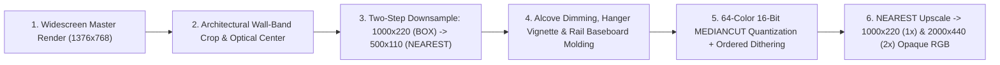

# Horizon Stage Backdrop Authoring Guide (`DealerStageCanvas`)

This document specifies the geometry, texel-density math, prompt engineering rules, architectural crop/centering formulas, UI clearance zones, 16-bit palette quantization pipeline, and verification protocols for authoring panoramic Horizon Stage backdrops (`assets/haunted/backdrops/backdrop_*.png`) in Blackjack.

---

## 1. Horizon Stage Geometry & Locked `2x2` Texel Density

On the Horizon Stage (`ui_canvases.py:DealerStageCanvas`), the dealer puppet (`224x224` upscaled `2x` via `NEAREST` from a `112x112` logical pixel grid) stands centered at `(w // 2, h)` above the 3D mahogany Horizon Rail.



### Why `1000x220` (`500x110` Logical Grid) Is Mandatory
- `DealerStageCanvas.DEFAULT_HEIGHT` is **`220` px** (`width = 1000` px at `1x`, `2000x440` at `2x`).
- In [`DealerStageCanvas._redraw_stage()`](../ui_canvases.py), the active backdrop image is scaled to `(w, h)` via `raw_img.resize((w, h), Image.Resampling.NEAREST)`.
- **Historical Pitfall**: Legacy backdrops were generated at `1000x140`, which caused `resize((1000, 220), NEAREST)` to stretch every backdrop vertically by **`1.57x`** (`220 / 140`), creating uneven rectangular pixels (`1.0x` wide by `1.57x` tall) that clashed with the dealer puppet's square `2x2` pixels.
- **The `500x110` Logical Grid Invariant**:
  - Every backdrop in [`tools/build_stage_backdrops.py`](../tools/build_stage_backdrops.py) is authored and quantized at **`LOGICAL_W = 500, LOGICAL_H = 110`**.
  - It is then upscaled `2x` with `Image.Resampling.NEAREST` to **`1000x220`** (`backdrop_<theme>.png`) and `4x` with `Image.Resampling.NEAREST` to **`2000x440`** (`backdrop_<theme>_2x.png`).
  - At runtime (`1000x220`), `resize((1000, 220), NEAREST)` is an exact `1:1` identity operation: every brick, wood grain highlight, candle flame, stained-glass pane, and neon sign in the backdrop is a true **`2x2` square pixel block**, identical to the `224x224` dealer puppet standing in front of it.

---

## 2. Prompt Engineering for 16-Bit Panoramic Masters (`image-generator`)

When generating a new stage backdrop master (`assets/haunted/backdrops/masters/master_<theme>.jpg`), use the `image-generator` subagent with these four mandatory compositional constraints:

1. **Zero Characters or People**:
   - Always include: *"NO people or characters in the scene."* The backdrop is an architectural stage set for the foreground puppet.
2. **Symmetrical Central Archway / Alcove (`x = 40%..60%`)**:
   - Always specify: *"Symmetrical architectural wall composition: a darker recessed archway/alcove in the exact center to frame a foreground dealer character."*
   - Why: A recessed dark archway in the center (`x_1000 = 388..612`) naturally frames the `224x224` dealer bust and prevents busy background details or bright highlights from competing with the dealer's face and animated hands.
3. **Rich Environmental Wings (`x = 0%..40%` and `x = 60%..100%`)**:
   - Place the primary architectural storytelling on the left and right wings flanking the central arch:
     - `casino`: Carved mahogany wainscoting, gold damask panels, glowing crystal wall sconces, and a continuous emerald/crimson scalloped velvet valance across the top edge.
     - `creep`: Peeling Victorian wallpaper revealing damp stone brick, crooked gilt picture frames, flickering amber/violet sconces with dripping wax, and cobwebs.
     - `crypt`: Ashlar stone masonry, pointed gothic lancet windows framing a glowing full moon and night clouds, wrought-iron candelabras, gargoyle/skull corbels, and crimson bat banners.
     - `hell`: Jagged black-iron and obsidian pillars, glowing molten lava waterfalls on both wings, hanging iron chains, and cracked magma veins.
     - `celestial`: Fluted ivory-and-gold marble columns, towering sapphire/cyan/gold gothic stained-glass lancet windows, crepuscular golden light beams, and golden clouds along the base.
     - `cyber`: Brushed-titanium central arch, glowing cyan/pink circuit columns, and wide rain-streaked windows overlooking a neon magenta/cyan cyberpunk city skyline and holographic pagoda.
     - `academy`: Floor-to-ceiling mahogany bookshelves with labeled sections, flanking oak-framed green slate chalkboards with Hi-Lo probability charts and bell curves, and glowing green brass banker's lamps.
4. **Crunchy 16-Bit SNES/GBA Pixel Aesthetic**:
   - Specify: *"16-bit SNES GBA crunchy pixel art, crisp `1px` `#121016` dark pixel outlines, hand-placed pixel clusters, ordered Bayer dithering."*

---

## 3. Architectural Wall-Band Cropping & Optical Centering (`THEME_SPECS`)

Master renders generated by `image-generator` are widescreen `16:9` (`1376x768`), whereas the Horizon Stage is a wide panoramic ribbon (`1000x220`, aspect ratio `4.54:1`).

### Rule 1: Crop the Architectural Wall Band (Exclude Foreground Floors)
Never squash the entire `768px` vertical height into `220px`—doing so compresses vertical architecture by `3.5x` and leaves dead empty floor space at the bottom of the stage. Instead, crop the **architectural wall band** (`crop = (x0, y0, x1, y1)` in `THEME_SPECS`) so column bases, wainscoting panels, window sills, and chalk trays ground directly onto the Horizon Rail (`y = 220`):

| Theme | Master Crop `(x0, y0, x1, y1)` | What the Vertical Band Captures |
| :--- | :---: | :--- |
| `casino` | `(0, 0, 1376, 640)` | Full scalloped emerald/crimson velvet valance (`y = 0`) down to mahogany wainscoting base (`y = 640`), excluding marble floor. |
| `creep` | `(0, 0, 1376, 660)` | Tattered valance & cobwebs (`y = 0`) down to rotting wainscoting base (`y = 660`). |
| `crypt` | `(0, 10, 1376, 655)` | Gargoyle corbels & gothic arches (`y = 10`) down to candelabra bases & skulls along the wall ledge (`y = 655`). |
| `hell` | `(0, 15, 1348, 615)` | Volcanic cavern arches (`y = 15`) down to molten lava pools (`y = 615`), with `x1 = 1348` to optically center the dark obsidian arch at `x = 500`. |
| `celestial` | `(0, 0, 1376, 650)` | Stained-glass lancet windows & light rays (`y = 0`) down to golden cloud bank & column bases (`y = 650`). |
| `cyber` | `(0, 10, 1376, 585)` | Kanji LED ceiling cornice (`y = 10`) down to panoramic window sill & titanium arch steps (`y = 585`). |
| `academy` | `(0, 80, 1376, 625)` | Mahogany pediment `"CARD-COUNTING SEMINAR"` (`y = 80`) down to green banker's lamps & chalk trays (`y = 625`). |

### Rule 2: Optical Archway Centering (`x_500 = 250` / `x_1000 = 500`)
Because the dealer puppet is anchored at `x = w // 2` (`x = 500` at `1x`), the central archway in the backdrop must be centered at `x_src_center = (x0 + x1) / 2`.
- If the generated master's central archway is slightly left of center (e.g., at `x_src = 674` instead of `688` in a `1376px` image), set `x0 = 0, x1 = 674 * 2 = 1348` (or if right of center at `x_src = 702`, set `x0 = 28, x1 = 1376`) so the archway aligns dead-center behind the dealer puppet.

---

## 4. Stage UI Clearance Zones & Contrast Framing

Every Horizon Stage backdrop shares the viewport with three foreground UI elements that must remain 100% legible at all times:

```text
+--------------------------------------------------------------------------------------------------+
|                                                        [Zone 3: Wardrobe Hanger (x=962, y=4)] 🧥 |
|                                        +--------------+                                          |
|  +----------------------------------+  |              |                                          |
|  | Zone 2: Dialogue Nameplate &     |  |   Zone 1:    |      Right Architectural Wing            |
|  | Speech Bubble (x=108..412,       |->|   Dealer     |      (x = 612 .. 960)                    |
|  |                y=78..130)        |  |   Puppet     |                                          |
|  +----------------------------------+  |  (224 x 224) |                                          |
|      Left Architectural Wing           |  x=388..612  |                                          |
|      (x = 0 .. 388)                    +--------------+                                          |
|==================================================================================================|
|                         Zone 4: Bottom Horizon Rail Baseboard (y = 216..220)                     |
+--------------------------------------------------------------------------------------------------+
```

1. **Zone 1 — Central Dealer Alcove (`x_500 = 210..290`, `x_1000 = 420..580`)**:
   - If the master image contains bright light fixtures inside the central arch (such as the twin interior sconces in `master_casino.jpg`), configure `center_dim = (cx0, cx1, cy0, cy1, factor)` in `THEME_SPECS` (e.g., `(210, 290, 38, 96, 0.58)`).
   - [`_build_crunchy_backdrop_pair()`](../tools/build_stage_backdrops.py) applies a cosine-feathered luminance multiplier across that box on the `500x110` grid *before* palette quantization, preserving the damask/wood pixel art while guaranteeing high silhouette contrast behind the dealer.
2. **Zone 2 — Left Dialogue Nameplate & Speech Bubble (`x_1000 = 108..412, y_1000 = 75..130`)**:
   - The theatrical dealer nameplate and speech bubble float to the left of the dealer (`anchor_offset = (-76, -90)`). Left-wing details above `y = 75` and below `y = 130` (such as top valances, bookshelves, stained-glass arches, and banker's lamps) frame the nameplate box above and below.
3. **Zone 3 — Top-Right Wardrobe Hanger Button (`x_1000 = 962..990, y_1000 = 4..32`)**:
   - `_build_crunchy_backdrop_pair()` automatically applies a subtle radial dark vignette at `x_500 = 466..500, y_500 = 0..24` (`0.45x` at `(488, 9)`) so the golden brass coat-hanger icon (`hanger_icon.png`, `28x28` with `#121016` `1px` dark pixel outline) stands out cleanly against bright stained glass or marble columns.
4. **Zone 4 — Bottom Horizon Rail Baseboard (`y_500 = 108..109`, `y_1000 = 216..220`)**:
   - Row `y_500 = 108` blends the theme's `rail_hi` accent color (`65%` `rail_hi` + `35%` wall pixel), and row `y_500 = 109` sets `rail_shd`, creating a crisp `4px` (`1x`) / `8px` (`2x`) pixel-art baseboard molding that grounds the wall into the 3D Horizon Rail.

---

## 5. Two-Step Crunchy Downsampling & 16-Bit Palette Quantization

In [`_build_crunchy_backdrop_pair()`](../tools/build_stage_backdrops.py):
1. **Two-Step Downsample (`1376x768 crop` $\to$ `1000x220 BOX` $\to$ `500x110 NEAREST`)**:
   - First averaging to `1000x220` with `Image.Resampling.BOX` and then snapping to `500x110` with `Image.Resampling.NEAREST` preserves crisp `1px` `#121016` outlines without muddy bilinear blur.
2. **64-Color 16-Bit Adaptive Quantization**:
   - Quantizing the `500x110` image via `quantize(colors=64, method=Image.Quantize.MEDIANCUT, dither=Image.Dither.FLOYDSTEINBERG).convert("RGB")` locks the entire scene to a cohesive 64-color 16-bit palette with authentic pixel dithering across light halos and stone/wood gradients.
3. **100% Opaque RGB Output (`NEAREST` Upscale to `1000x220` & `2000x440`)**:
   - Upscaling the quantized `500x110` image via `Image.Resampling.NEAREST` produces exact `2x2` (`1000x220`) and `4x4` (`2000x440`) pixel blocks in `"RGB"` mode (`min_alpha == 255`), preventing Tkinter alpha-keying leakage.

---

## 6. End-to-End Checklist for Adding a New Backdrop Theme

When adding a new stage theme `<theme>` (e.g., for a new dealer or narrative phase):

1. **Save Master & Configure `THEME_SPECS`**:
   - Save the `1376x768` master render to `assets/haunted/backdrops/masters/master_<theme>.jpg`.
   - Add `"<theme>"` to `THEME_SPECS` in [`tools/build_stage_backdrops.py`](../tools/build_stage_backdrops.py) and add a `create_<theme>_backdrop()` helper if needed.
   - Run `python tools/build_stage_backdrops.py` to generate `backdrop_<theme>.png` (`1000x220`) and `backdrop_<theme>_2x.png` (`2000x440`).
2. **Register in `DealerStageCanvas`**:
   - Add `"<theme>": ("backdrop_<theme>.png", "backdrop_<theme>_2x.png")` to `theme_files` in [`DealerStageCanvas._load_backdrop_assets()`](../ui_canvases.py).
   - Optionally add theme-specific ambient particles in [`DealerStageCanvas.spawn_ambient_particles()`](../ui_canvases.py).
3. **Wire to Dealer Profile or Game Phase**:
   - Set `theme="<theme>"` on the `DealerProfile` in [`dealer_actor.py`](../dealer_actor.py) (or phase transition in [`blackjack.py:_apply_phase_theme()`](../blackjack.py)).
4. **Add to Automated Tests & Docs**:
   - Add `"backdrop_<theme>.png"` and `"backdrop_<theme>_2x.png"` to `REQUIRED_BACKDROPS` in [`tests/test_dealer_stage_canvas.py`](../tests/test_dealer_stage_canvas.py).
   - Document the new theme in [`assets/haunted/backdrops/README.md`](../assets/haunted/backdrops/README.md).

---

## 7. Visual & Automated Verification Protocol

1. **Render a Full-Stage Composite Preview**:
   Composite the `1000x220` backdrop with its `224x224` dealer puppet at `(388, -4)`, the top-right `hanger_icon.png` at `(962, 4)`, and the left nameplate rectangle at `[108, 78, 412, 114]`, and inspect the PNG with `read_file` to verify:
   - [ ] Central archway frames the dealer puppet symmetrically at `x = 500`.
   - [ ] Dealer head and shoulders have strong contrast against the central alcove.
   - [ ] Top-right golden hanger icon is clearly visible.
   - [ ] Wall columns/wainscoting ground cleanly onto the bottom Horizon Rail (`y = 216..220`) with no floating floor gap.
   - [ ] Texel density matches the `2x2` chunky pixel size of the dealer puppet.
2. **Run Automated Stage & Smoke Tests**:
   ```powershell
   python -m unittest tests/test_dealer_stage_canvas.py tests/test_counting_bootcamp.py
   python run_tests.py smoke
   ```

